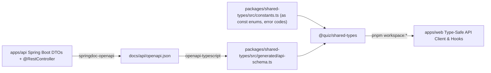

# Frontend-to-Backend API Integration & Contract Strategy

> **Document Status:** Architectural Blueprint (Pre-Implementation)
> **Verified Backend Coverage:** 1 endpoint (`GET /api/health`) out of ~42 required endpoints

---

## 1. Current Backend Audit (`apps/api`)

From direct inspection of `apps/api/pom.xml`, `src/main/java/com/quizplatform/api/HealthController.java`, and `src/main/resources/application.properties`:

- **IMPLEMENTED:**
  - `GET /api/health` -> returns `200 OK` JSON:
    ```json
    {
      "status": "UP",
      "message": "Quiz Platform API is running"
    }
    ```
  - Spring Boot Actuator is included in `pom.xml` (default actuator endpoints like `/actuator/health`).
- **MISSING IN BACKEND:**
  - Spring Security & JWT authentication/refresh infrastructure
  - PostgreSQL + Flyway + JPA entities (`User`, `Category`, `Quiz`, `Question`, `QuestionOption`, `QuizSession`, `SessionAnswer`, `Attempt`, `AiGenerationJob`)
  - All `/api/v1/*` domain controllers, DTOs, Jakarta Validation, `@RestControllerAdvice` (`ProblemDetail`), CORS configuration, and AI provider integration.

> [!WARNING]
> Every endpoint below marked **`PROPOSED`** does **not** exist in `apps/api` yet. Request and response schemas represent proposed contracts requiring backend team agreement before implementation.

---

## 2. Standard API Conventions (Recommended Agreement)

1. **Versioning Prefix:** Keep `GET /api/health` as-is; version all domain endpoints under `/api/v1/*`.
2. **Error Format (Spring Boot 4 `ProblemDetail` RFC 9457):**
   ```json
   {
     "type": "https://api.quizplatform.local/errors/validation",
     "title": "Validation Failed",
     "status": 422,
     "detail": "One or more fields are invalid.",
     "instance": "/api/v1/quizzes",
     "code": "VALIDATION_ERROR",
     "fieldErrors": {
       "title": "Title must be between 3 and 120 characters"
     }
   }
   ```
3. **Pagination Envelope (`PageResponse<T>`):**
   ```json
   {
     "items": [],
     "page": 0,
     "size": 12,
     "totalItems": 48,
     "totalPages": 4,
     "hasNext": true
   }
   ```
4. **Timestamps:** Always ISO-8601 UTC strings (`2026-11-25T08:45:00Z`).
5. **Vite Dev Proxy:** Configure `apps/web/vite.config.ts` to proxy `/api` -> `http://localhost:8080` so frontend calls relative `/api/v1/...` paths seamlessly with cookies in local development.

---

## 3. Master Page-to-API Integration Matrix

| Page | HTTP Method | Endpoint | Request Data | Response Data | Backend Status |
|---|---|---|---|---|---|
| **System Health Check** (App/Status) | `GET` | `/api/health` | None | `{ status: "UP", message: string }` | **IMPLEMENTED** |
| **Landing (`/`) & Explore (`/explore`)** | `GET` | `/api/v1/public/quizzes` | Query: `q`, `categoryId`, `difficulty`, `sort`, `page`, `size` | `PageResponse<PublicQuizSummary>` | **PROPOSED** |
| **Explore (`/explore`), Create/Edit/AI** | `GET` | `/api/v1/categories` | Query: `activeOnly=true` | `CategoryDto[]` (`id`, `name`, `slug`, `quizCount`) | **PROPOSED** |
| **Public Quiz Details (`/explore/:quizId`)** | `GET` | `/api/v1/public/quizzes/:quizId` | Path: `quizId` | `PublicQuizDetail` (no questions/answers) | **PROPOSED** |
| **Contact (`/contact`)** | `POST` | `/api/v1/public/contact` | `{ name, email, subject, message }` | `202 Accepted` `{ ticketId }` | **PROPOSED** |
| **Login (`/login`)** | `POST` | `/api/v1/auth/login` | `{ email, password }` | `{ accessToken, expiresInSeconds, user: UserSummary }` + `Set-Cookie: refresh_token` (HttpOnly) | **PROPOSED** |
| **Silent Bootstrap / Interceptor** | `POST` | `/api/v1/auth/refresh` | `HttpOnly refresh_token` cookie | `{ accessToken, expiresInSeconds, user: UserSummary }` | **PROPOSED** |
| **Sign Out (Header Menu)** | `POST` | `/api/v1/auth/logout` | `HttpOnly refresh_token` cookie | `204 No Content` (clears cookie) | **PROPOSED** |
| **Register (`/register`)** | `POST` | `/api/v1/auth/register` | `{ displayName, email, password }` | `{ accessToken, expiresInSeconds, user }` (or `{ message }` if email verification added) | **PROPOSED** |
| **Forgot Password (`/forgot-password`)** | `POST` | `/api/v1/auth/forgot-password` | `{ email }` | `202 Accepted` `{ message }` | **PROPOSED** |
| **Reset Password (`/reset-password`)** | `POST` | `/api/v1/auth/reset-password` | `{ token, newPassword }` | `200 OK` `{ message }` | **PROPOSED** |
| **Dashboard (`/app/dashboard`)** | `GET` | `/api/v1/analytics/summary` | None | `{ totalAttempts, completedAttempts, averageScorePercent, bestScorePercent }` | **PROPOSED** |
| **Dashboard (`/app/dashboard`)** | `GET` | `/api/v1/quizzes/recommended` | Query: `limit=4` | `QuizSummary[]` (optional; fallback to popular `/api/v1/quizzes`) | **PROPOSED** |
| **My Quizzes & Library (`/app/quizzes`)** | `GET` | `/api/v1/quizzes` | Query: `q`, `categoryId`, `difficulty`, `sort`, `page`, `size` | `PageResponse<QuizSummary>` | **PROPOSED** |
| **My Quizzes (`/app/quizzes?tab=mine`)** | `GET` | `/api/v1/quizzes/mine` | Query: `q`, `status`, `difficulty`, `page`, `size` | `PageResponse<OwnedQuizSummary>` | **PROPOSED** |
| **My Quizzes (`/app/quizzes`)** | `DELETE` | `/api/v1/quizzes/:quizId` | Path: `quizId` | `204 No Content` | **PROPOSED** |
| **My Quizzes / Edit Quiz** | `PATCH` | `/api/v1/quizzes/:quizId/status` | `{ status: "DRAFT" \| "PUBLISHED" \| "ARCHIVED" }` | `{ id, status, updatedAt }` | **PROPOSED** |
| **Create Quiz (`/app/quizzes/create`)** | `POST` | `/api/v1/quizzes` | `{ title, description, categoryId, difficulty, durationMinutes, passingScorePercent?, status, source: "MANUAL" \| "AI", questions: CreateQuestionInput[] }` | `201 Created` `QuizManageDetail` | **PROPOSED** |
| **Quiz Details (`/app/quizzes/:quizId`)** | `GET` | `/api/v1/quizzes/:quizId` | Path: `quizId` | `QuizDetail` (metadata + user permissions + activeSessionId if any) | **PROPOSED** |
| **Quiz Details (`/app/quizzes/:quizId`)** | `POST` | `/api/v1/quizzes/:quizId/sessions` | Path: `quizId` | `201 Created` (or `200 OK` if resuming) `{ sessionId, status }` | **PROPOSED** |
| **Edit Quiz (`/app/quizzes/:quizId/edit`)** | `GET` | `/api/v1/quizzes/:quizId/manage` | Path: `quizId` | `QuizManageDetail` (includes correct options & explanations for owner) | **PROPOSED** |
| **Edit Quiz (`/app/quizzes/:quizId/edit`)** | `PUT` | `/api/v1/quizzes/:quizId` | `{ title, description, categoryId, difficulty, durationMinutes, passingScorePercent?, questions: UpsertQuestionInput[] }` | `200 OK` `QuizManageDetail` | **PROPOSED** |
| **AI Generator (`/app/ai/generate`)** | `POST` | `/api/v1/ai/quizzes/generate` | `{ topic, categoryId, difficulty, questionCount, durationMinutes, instructions? }` + `Idempotency-Key` | `202 Accepted` `{ jobId, status: "PENDING" }` | **PROPOSED** |
| **AI Generator (`/app/ai/generate`)** | `GET` | `/api/v1/ai/jobs/:jobId` | Path: `jobId` | `{ jobId, status: "PENDING"\|"PROCESSING"\|"COMPLETED"\|"FAILED", draftQuiz?, errorMessage? }` | **PROPOSED** |
| **AI Generator (`/app/ai/generate`)** | `POST` | `/api/v1/ai/jobs/:jobId/questions/:index/regenerate` | `{ feedback? }` | `{ index, question: GeneratedQuestionDto }` | **PROPOSED** |
| **Instructions & Play (`/app/sessions/:sessionId/*`)** | `GET` | `/api/v1/sessions/:sessionId` | Path: `sessionId` | `QuizSessionDetail` (`sessionId`, `quizTitle`, `status`, `serverNow`, `startedAt`, `expiresAt`, `questions[]` **WITHOUT `isCorrect` or `explanation`**, `savedAnswers[]`) | **PROPOSED** |
| **Instructions (`/app/sessions/:sessionId/instructions`)** | `POST` | `/api/v1/sessions/:sessionId/begin` | Path: `sessionId` | `{ sessionId, status: "IN_PROGRESS", serverNow, startedAt, expiresAt }` | **PROPOSED** |
| **Quiz Play (`/app/sessions/:sessionId/play`)** | `PUT` | `/api/v1/sessions/:sessionId/answers` | `{ questionId, selectedOptionIds: string[] }` | `{ questionId, savedAt, serverNow }` | **PROPOSED** |
| **Quiz Play (`/app/sessions/:sessionId/play`)** | `POST` | `/api/v1/sessions/:sessionId/submit` | `{ clientSubmittedAt? }` + `Idempotency-Key` | `{ sessionId, attemptId, status: "SUBMITTED" }` | **PROPOSED** |
| **Quiz Result (`/app/sessions/:sessionId/result`)** | `GET` | `/api/v1/sessions/:sessionId/result` | Path: `sessionId` | `SessionResultDto` (`attemptId`, `quizId`, `quizTitle`, `scorePercent`, `correctCount`, `totalQuestions`, `unansweredCount`, `passed`, `timeSpentSeconds`, `submittedAt`) | **PROPOSED** |
| **Attempt History (`/app/attempts`)** | `GET` | `/api/v1/attempts` | Query: `q`, `quizId`, `status`, `page`, `size`, `sort` | `PageResponse<AttemptSummary>` | **PROPOSED** |
| **Attempt Review (`/app/attempts/:attemptId`)** | `GET` | `/api/v1/attempts/:attemptId` | Path: `attemptId` | `AttemptReviewDetail` (summary + questions with `selectedOptionIds`, `correctOptionIds`, `isCorrect`, `explanation`) | **PROPOSED** |
| **Analytics (`/app/analytics`)** | `GET` | `/api/v1/analytics/overview` | Query: `range` (`7d`\|`30d`\|`90d`\|`all`) | `{ totalAttempts, completedAttempts, averageScorePercent, bestScorePercent, totalStudySeconds }` | **PROPOSED** |
| **Analytics (`/app/analytics`) & Dashboard** | `GET` | `/api/v1/analytics/trends` | Query: `range` | `Array<{ date, averageScorePercent, attemptCount }>` | **PROPOSED** |
| **Analytics (`/app/analytics`)** | `GET` | `/api/v1/analytics/by-category` | Query: `range` | `Array<{ categoryId, categoryName, averageScorePercent, attemptCount }>` | **PROPOSED** |
| **Analytics (`/app/analytics`)** | `GET` | `/api/v1/analytics/by-difficulty` | Query: `range` | `Array<{ difficulty, averageScorePercent, attemptCount, passRatePercent }>` | **PROPOSED** |
| **Global Leaderboard (`/app/leaderboard`)** | `GET` | `/api/v1/leaderboards/global` | Query: `timeframe` (`weekly`\|`monthly`\|`all`), `page`, `size` | `{ currentUserEntry?, entries: PageResponse<GlobalLeaderboardEntry> }` | **PROPOSED** |
| **Quiz Leaderboard (`/app/quizzes/:quizId/leaderboard`)** | `GET` | `/api/v1/leaderboards/quizzes/:quizId` | Query: `page`, `size` | `{ currentUserEntry?, entries: PageResponse<QuizLeaderboardEntry> }` | **PROPOSED** |
| **Profile (`/app/profile`)** | `GET` | `/api/v1/users/me` | None | `UserProfileDto` (`id`, `email`, `displayName`, `bio`, `roles`, `createdAt`, `stats`) | **PROPOSED** |
| **Profile (`/app/profile`)** | `PATCH` | `/api/v1/users/me` | `{ displayName, bio }` | `UserProfileDto` | **PROPOSED** |
| **Settings (`/app/settings`)** | `PUT` | `/api/v1/users/me/password` | `{ currentPassword, newPassword }` | `204 No Content` | **PROPOSED** |
| **Settings (`/app/settings`)** | `GET` / `PATCH` | `/api/v1/users/me/preferences` | `{ theme?: "system"\|"light"\|"dark" }` | `{ theme }` (optional; can start local-only) | **PROPOSED** |
| **Admin Dashboard (`/admin`)** | `GET` | `/api/v1/admin/analytics/overview` | None | `{ totalUsers, publishedQuizzes, attemptsLast24h, aiJobsLast24h, aiFailureRatePercent }` | **PROPOSED** |
| **Admin Users (`/admin/users`)** | `GET` | `/api/v1/admin/users` | Query: `q`, `role`, `status`, `page`, `size` | `PageResponse<AdminUserSummary>` | **PROPOSED** |
| **Admin Users (`/admin/users`)** | `PATCH` | `/api/v1/admin/users/:userId/status` | `{ status: "ACTIVE" \| "SUSPENDED" }` | `AdminUserSummary` | **PROPOSED** |
| **Admin Users (`/admin/users`)** | `PATCH` | `/api/v1/admin/users/:userId/roles` | `{ roles: Role[] }` | `AdminUserSummary` | **PROPOSED** |
| **Admin Quizzes (`/admin/quizzes`)** | `GET` | `/api/v1/admin/quizzes` | Query: `q`, `status`, `source`, `page`, `size` | `PageResponse<AdminQuizSummary>` | **PROPOSED** |
| **Admin Quizzes (`/admin/quizzes`)** | `PATCH` | `/api/v1/admin/quizzes/:quizId/moderation` | `{ action: "APPROVE" \| "UNPUBLISH" \| "ARCHIVE", reason? }` | `AdminQuizSummary` | **PROPOSED** |
| **Admin Categories (`/admin/categories`)** | `POST` / `PUT` / `DELETE` | `/api/v1/admin/categories` (`/:id`) | `{ name, description?, active? }` | `CategoryDto` / `204 No Content` | **PROPOSED** |
| **Admin AI Monitoring (`/admin/ai-monitoring`)** | `GET` | `/api/v1/admin/ai/metrics` & `/api/v1/admin/ai/jobs` | Query: `status`, `page`, `size` | Metrics summary + `PageResponse<AdminAiJobLog>` | **PROPOSED** |

---

## 4. `packages/shared-types` & Contract Synchronization Strategy

Currently `packages/shared-types/` is an empty directory. Because Java Spring Boot DTOs and TypeScript interfaces do not share a compiler, manually copying DTO shapes leads to silent drift.

### Recommended Contract Pipeline



1. **Make `packages/shared-types` a workspace package (`@quiz/shared-types`):**
   - Contains `package.json`, `tsconfig.json`, `src/index.ts`.
   - Must respect `erasableSyntaxOnly: true` (use `export const QUIZ_DIFFICULTY = { EASY: 'EASY', MEDIUM: 'MEDIUM', HARD: 'HARD' } as const` instead of `enum`).
2. **Phase-1 (Before OpenAPI exists):** Hand-author agreed TypeScript contracts in `packages/shared-types/src/contracts/` (e.g., `auth.ts`, `quiz.ts`, `session.ts`, `analytics.ts`, `common.ts`) so both Spring Boot implementation and React MSW mocks target the exact same contract.
3. **Phase-2 (Once Spring Boot controllers exist):** Add `springdoc-openapi-starter-webmvc-ui` to `apps/api/pom.xml`, export `docs/api/openapi.json` via CI/script, and run `openapi-typescript` to generate `packages/shared-types/src/generated/schema.d.ts`, checking diffs in PRs.
