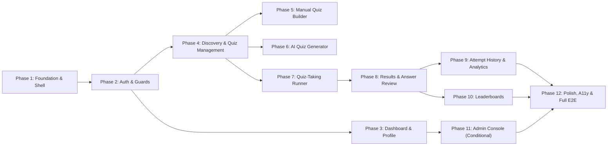

# Phased Frontend Implementation Roadmap

> **Document Status:** Architectural Blueprint (Pre-Implementation)
> **Strategy:** Deliver working end-to-end vertical slices sequentially; never build disconnected mock pages without clear backend contracts.

---

## Dependency Overview

> [!IMPORTANT]
> **Backend Readiness Gate:** Currently only `GET /api/health` exists in `apps/api`. Each phase explicitly states its **Backend Prerequisites**. During development, frontend phases can proceed using typed MSW mocks matching `packages/shared-types` and immediately switch to live Spring Boot endpoints as each backend module lands.

---

## Phase 1: Frontend Foundation, Tooling & Application Shell
- **Goal:** Replace Vite starter boilerplate with production folder structure, design tokens, routing shell, API client, and public informational pages.
- **Pages:** `/`, `/about`, `/contact`, `/privacy`, `/terms`, `/403`, `*` (404).
- **Components:** `PublicLayout`, `PublicNavbar`, `PublicFooter`, `AppShellLayout` (skeleton), `Button`, `Input`, `Card`, `Badge`, `Alert`, `Modal`, `Toast`, `Skeleton`, `EmptyState`, `ErrorBoundary`.
- **API Dependencies:** `GET /api/health` (**IMPLEMENTED**); optional `POST /api/v1/public/contact` (**PROPOSED**).
- **Backend Prerequisites:** Configure Spring Boot CORS or Vite `/api` proxy (`vite.config.ts`).
- **Acceptance Criteria:**
  - `apps/web` compiles cleanly (`pnpm build:web` & `pnpm lint:web`) with `erasableSyntaxOnly: true`.
  - `@quiz/shared-types` package initialized and linked via `pnpm` workspace.
  - Design tokens (`tokens.css`) and light/dark themes render consistently across desktop and mobile.
- **Tests:** Vitest setup verified; unit tests for `api-client.ts` `ProblemDetail` parsing and `Button`/`Modal` accessibility.

---

## Phase 2: Authentication & Route Protection
- **Goal:** Full registration, login, password reset flow, memory access-token management, and protected route guards.
- **Pages:** `/login`, `/register`, `/forgot-password`, `/reset-password`.
- **Components:** `AuthLayout`, `AuthCard`, `LoginForm`, `RegisterForm`, `ForgotPasswordForm`, `ResetPasswordForm`, `PasswordInput`, `PasswordStrengthMeter`, `RequireAuth`, `RequireGuest`, `RequireRole`.
- **API Dependencies:** `POST /api/v1/auth/login`, `POST /api/v1/auth/register`, `POST /api/v1/auth/refresh`, `POST /api/v1/auth/logout`, `POST /api/v1/auth/forgot-password`, `POST /api/v1/auth/reset-password` (all **PROPOSED**).
- **Backend Prerequisites:** Spring Security filter chain, JWT issuer/validator, `HttpOnly` refresh cookie endpoint, User entity & Flyway migration.
- **Acceptance Criteria:**
  - Silent refresh restores session on browser reload without flicker.
  - Unauthenticated access to `/app/*` redirects to `/login?redirect=...` and returns user after login.
  - Parallel `401` responses trigger only **one** refresh call (single-flight lock).
- **Tests:** RTL + MSW tests for Login/Register validation, `401` refresh retry, `RequireAuth` & `RequireRole` redirects.

---

## Phase 3: Dashboard & User Profile / Settings
- **Goal:** Establish the logged-in workspace landing experience and account management.
- **Pages:** `/app/dashboard` (initial KPIs + quick actions), `/app/profile`, `/app/settings`.
- **Components:** `PageHeader`, `StatCard`, `ProfileIdentityCard`, `ProfileForm`, `ChangePasswordCard`, `AppearancePreferencesCard`, `UserMenuDropdown`.
- **API Dependencies:** `GET /api/v1/users/me`, `PATCH /api/v1/users/me`, `PUT /api/v1/users/me/password`, `GET /api/v1/analytics/summary`, `GET /api/v1/attempts?limit=5` (all **PROPOSED**).
- **Backend Prerequisites:** User profile endpoints + baseline empty-safe analytics summary endpoint.
- **Acceptance Criteria:**
  - New users see actionable onboarding empty state on `/app/dashboard`.
  - Profile updates reflect immediately in `AppTopHeader` / `UserMenuDropdown`.
  - Wrong current password shows field-level error on `/app/settings`.
- **Tests:** RTL tests for profile edit, password change validation, and dashboard widget independent error/empty states.

---

## Phase 4: Quiz Discovery & Quiz Management
- **Goal:** Allow guests and authenticated users to browse, filter, inspect, and manage quizzes.
- **Pages:** `/explore`, `/explore/:quizId`, `/app/quizzes`, `/app/quizzes/:quizId`.
- **Components:** `QuizCard`, `SearchInput`, `FilterBar`, `Pagination`, `DifficultyBadge`, `QuizStatusBadge`, `QuizActionsMenu`, `ConfirmDialog`.
- **API Dependencies:** `GET /api/v1/public/quizzes`, `GET /api/v1/public/quizzes/:quizId`, `GET /api/v1/categories`, `GET /api/v1/quizzes`, `GET /api/v1/quizzes/mine`, `GET /api/v1/quizzes/:quizId`, `PATCH /api/v1/quizzes/:quizId/status`, `DELETE /api/v1/quizzes/:quizId` (all **PROPOSED**).
- **Backend Prerequisites:** `Category` & `Quiz` entities, public vs authenticated visibility filtering, ownership enforcement.
- **Acceptance Criteria:**
  - URL query params (`?q=`, `?category=`, `?difficulty=`, `?page=`) stay synced and shareable.
  - Guests clicking Start on `/explore/:quizId` return to `/app/quizzes/:quizId` right after login.
  - Owners can publish, archive, and delete their own quizzes with confirmation.
- **Tests:** RTL + MSW tests for URL filter synchronization, tab switching (`All` vs `My Quizzes`), and delete confirmation.

---

## Phase 5: Manual Quiz Creation & Question Management
- **Goal:** Enable users to author and edit complete multi-question quizzes manually.
- **Pages:** `/app/quizzes/create`, `/app/quizzes/:quizId/edit`.
- **Components:** `QuizMetadataForm`, `QuestionBuilderList`, `QuestionEditorCard`, `OptionEditorRow`.
- **API Dependencies:** `POST /api/v1/quizzes`, `GET /api/v1/quizzes/:quizId/manage`, `PUT /api/v1/quizzes/:quizId` (all **PROPOSED**).
- **Backend Prerequisites:** Transactional Quiz + Question + Option persistence, ownership authorization (`403` if non-owner edits), Jakarta validation.
- **Acceptance Criteria:**
  - Users can add, reorder, duplicate, and remove questions and options (`2–6` options per question).
  - Unsaved changes prompt confirmation before navigating away.
  - Quiz can be saved as `DRAFT` or `PUBLISHED` and immediately opened in `/app/quizzes/:quizId`.
- **Tests:** RTL tests for dynamic question array validation (e.g., preventing publish with 0 questions or no correct option) and edit hydration.

---

## Phase 6: AI Quiz Generator
- **Goal:** Deliver an asynchronous, resilient AI quiz drafting and editing workflow.
- **Pages:** `/app/ai/generate`.
- **Components:** `AiConfigForm`, `AiJobProgressCard`, `GeneratedQuestionList`, `GeneratedQuestionCard`, `QuizPreviewModal`.
- **API Dependencies:** `POST /api/v1/ai/quizzes/generate`, `GET /api/v1/ai/jobs/:jobId`, `POST /api/v1/ai/jobs/:jobId/questions/:index/regenerate`, `POST /api/v1/quizzes` (all **PROPOSED**).
- **Backend Prerequisites:** Backend AI provider integration (server-side API key), async job table/queue (`AiGenerationJob`), structured JSON output validation, rate limiting (`429`).
- **Acceptance Criteria:**
  - Job polling transitions smoothly through `PENDING -> PROCESSING -> COMPLETED` or `FAILED`.
  - Failed generations preserve prompt inputs and support 1-click retry.
  - Users can edit, delete, or regenerate individual questions before saving as Draft or Published.
- **Tests:** MSW simulated async polling (`PENDING` -> `COMPLETED` and `PENDING` -> `FAILED`), single-question regeneration keeping sibling edits intact.

---

## Phase 7: Quiz-Taking Experience & Session Management
- **Goal:** Build the flagship distraction-free timed quiz runner with full resilience.
- **Pages:** `/app/sessions/:sessionId/instructions`, `/app/sessions/:sessionId/play`.
- **Components:** `QuizRunnerLayout`, `QuizRunnerHeader`, `CountdownTimer`, `QuestionStage`, `OptionCard`, `QuestionPalette`, `SubmitQuizModal`, `MultiTabConflictOverlay`.
- **API Dependencies:** `POST /api/v1/quizzes/:quizId/sessions`, `GET /api/v1/sessions/:sessionId`, `POST /api/v1/sessions/:sessionId/begin`, `PUT /api/v1/sessions/:sessionId/answers`, `POST /api/v1/sessions/:sessionId/submit` (all **PROPOSED**).
- **Backend Prerequisites:** `QuizSession` & `SessionAnswer` entities, server `expiresAt` deadline enforcement, answer-key omission during `IN_PROGRESS`, idempotent submission.
- **Acceptance Criteria:**
  - `GET /sessions/:id` never includes `isCorrect` or `explanation`.
  - Timer uses server `serverNow` clock-skew offset and auto-submits cleanly at `00:00`.
  - Page refresh restores saved answers and remaining time; offline answers queue and flush on reconnect; double-submit is prevented; multi-tab opens trigger conflict overlay.
- **Tests:** Vitest fake-timer tests for countdown + auto-submit; RTL + MSW tests for offline buffering, reload recovery, `409`/`410` expiry handling, and double-submit lock.

---

## Phase 8: Results & Answer Review
- **Goal:** Provide immediate score feedback and detailed post-attempt learning review.
- **Pages:** `/app/sessions/:sessionId/result`, `/app/attempts/:attemptId`.
- **Components:** `ResultBreakdownCard`, `AttemptSummaryHeader`, `AnswerReviewList`, `AnswerReviewCard`, `ProgressBar`.
- **API Dependencies:** `GET /api/v1/sessions/:sessionId/result`, `GET /api/v1/attempts/:attemptId` (all **PROPOSED**).
- **Backend Prerequisites:** Scoring engine computing score, pass/fail, time spent, and releasing `correctOptionIds` + `explanation` post-submission only.
- **Acceptance Criteria:**
  - Browser Back from `/result` does not re-open an active quiz session (`replace: true`).
  - `/attempts/:attemptId` supports filtering `All`, `Incorrect Only`, `Correct Only`, `Unanswered`.
- **Tests:** RTL tests verifying correct/incorrect option visual badges, filter tabs, and `403` handling when viewing another user's attempt.

---

## Phase 9: Attempt History & Performance Analytics
- **Goal:** Give learners historical attempt tracking and Recharts analytics dashboards.
- **Pages:** `/app/attempts`, `/app/analytics` (+ wire Trend Chart into `/app/dashboard`).
- **Components:** `DataTable`, `ChartContainer`, `PerformanceTrendChart`, `CategoryPerformanceChart`, `DifficultyPerformanceChart`, `AnalyticsRangeSelector`.
- **API Dependencies:** `GET /api/v1/attempts`, `GET /api/v1/analytics/overview`, `GET /api/v1/analytics/trends`, `GET /api/v1/analytics/by-category`, `GET /api/v1/analytics/by-difficulty` (all **PROPOSED**).
- **Backend Prerequisites:** Aggregated SQL/JPA analytics queries grouped by date, category, and difficulty.
- **Acceptance Criteria:**
  - Every chart renders clean loading skeleton, domain empty state (`< 2` attempts), custom tooltip, and mobile layout without horizontal overflow.
  - Date range selector (`7d`, `30d`, `90d`, `all`) updates overview KPIs and all charts together.
- **Tests:** RTL tests for range filter state, empty/error chart states, and attempt history pagination/filtering.

---

## Phase 10: Leaderboards
- **Goal:** Add competitive global and per-quiz rankings.
- **Pages:** `/app/leaderboard`, `/app/quizzes/:quizId/leaderboard`.
- **Components:** `LeaderboardPodium`, `CurrentUserRankBanner`, `LeaderboardTable`, `RankBadge`, `Avatar`.
- **API Dependencies:** `GET /api/v1/leaderboards/global`, `GET /api/v1/leaderboards/quizzes/:quizId` (all **PROPOSED**).
- **Backend Prerequisites:** Ranking query/materialized view with tie-breaking rules (score desc, completion time asc) and `currentUserEntry` projection.
- **Acceptance Criteria:**
  - Current user's rank is pinned clearly even if they are outside page 1.
  - Timeframe tabs (`Weekly`, `Monthly`, `All Time`) sync cleanly on global leaderboard.
- **Tests:** RTL tests for timeframe switching, empty leaderboard CTA, and current-user row highlighting.

---

## Phase 11: Administrator Console (Conditional on Backend Admin Scope)
- **Goal:** Deliver platform administration for users, quiz moderation, categories, and AI monitoring.
- **Pages:** `/admin`, `/admin/users`, `/admin/quizzes`, `/admin/categories`, `/admin/ai-monitoring`.
- **Components:** `AdminLayout`, `AdminOverviewCards`, `AdminUserTable`, `QuizModerationDrawer`, `CategoryFormModal`, `AiJobLogTable`.
- **API Dependencies:** All `/api/v1/admin/*` endpoints listed in `frontend-api-integration.md` (**PROPOSED**).
- **Backend Prerequisites:** `ROLE_ADMIN` authority, `@PreAuthorize("hasRole('ADMIN')")` endpoints, audit logging.
- **Acceptance Criteria:**
  - Non-admin users navigating to `/admin/*` are blocked by `RequireRole` and redirected to `/403`, and backend independently rejects non-admin requests with `403`.
  - Admins cannot suspend/demote their own active admin account from the UI.
- **Tests:** RTL tests for role guard enforcement, category CRUD conflict handling (`409`), and moderation drawer actions.

---

## Phase 12: Responsive Refinement, Accessibility Audit & End-to-End Integration
- **Goal:** Harden production readiness across viewports, screen readers, and real Spring Boot + PostgreSQL integration.
- **Scope:** All pages.
- **Acceptance Criteria:**
  - Zero `axe-core` critical/serious accessibility violations across core flows.
  - Responsive layout verified at `375px` (mobile), `768px` (tablet), and `1280px` (desktop).
  - Full Playwright E2E suite passes against running Spring Boot + PostgreSQL stack (or Testcontainers CI environment).
- **Tests (Playwright E2E Critical Journeys):**
  1. Register -> Login -> Dashboard -> Explore -> Take Quiz -> Submit -> Result -> Answer Review.
  2. Create Quiz Manually -> Publish -> Attempt -> View Quiz Leaderboard.
  3. AI Generate Quiz -> Edit Question -> Save & Publish.
  4. Quiz Session Reload Recovery + Countdown Expiry Auto-Submit.
  5. Mobile Navigation Drawer & Responsive Quiz Runner Flow.

---

## Key Architectural Decisions & Risks Requiring Approval

Before starting Phase 1 implementation, please review and approve:

1. **Additional Frontend Dependencies:** Approving installation of `react-router`, `tailwindcss` + `@tailwindcss/vite`, `lucide-react`, `recharts`, **`@tanstack/react-query`**, **`react-hook-form` + `zod`**, and testing tools (`vitest`, `@testing-library/react`, `msw`, `@playwright/test`).
2. **Auth Token Transport:** Confirming Spring Security will issue **HttpOnly Refresh Token cookies** + short-lived JSON Access Tokens (rather than storing refresh tokens in `localStorage`).
3. **AI Generation Execution Model:** Confirming whether `POST /api/v1/ai/quizzes/generate` will be **asynchronous (`202 Accepted` + `jobId` polling)** (recommended to avoid HTTP timeouts) or synchronous.
4. **Admin Scope Priority:** Confirming whether Admin pages (Phase 11) are in v1 scope or deferred until core learner/creator flows (Phases 1–10) are complete.
5. **Contract Sync Workflow:** Confirming `packages/shared-types` will host shared TypeScript DTO contracts initially and transition to `springdoc-openapi` -> `openapi-typescript` codegen once `apps/api` controllers are added.
