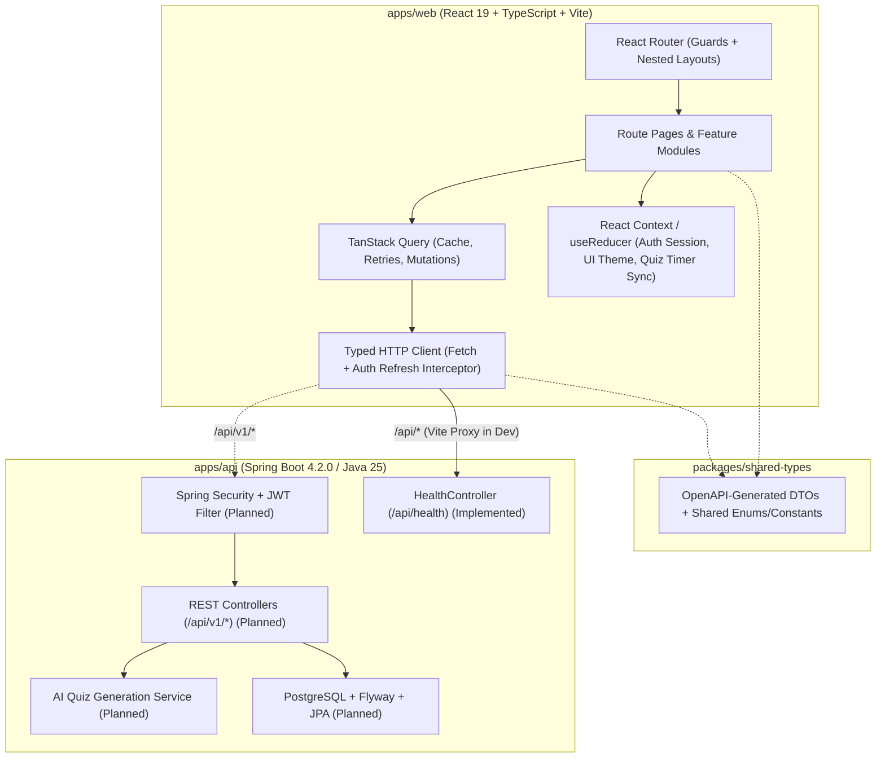

# Frontend Architecture Overview — AI-Powered Quiz Platform

> **Document Status:** Architectural Blueprint (Pre-Implementation)
> **Scope:** `apps/web` & `packages/shared-types` grounded in `ai_quiz_monorepo` inspection
> **Last Verified Against Repo:** November 25, 2026

---

## 1. Executive Summary & Monorepo Audit Findings

A thorough inspection of the repository reveals that **the monorepo is currently at initial project bootstrap ("Day 0" scaffold)**. Neither business logic nor domain APIs have been implemented yet in the frontend or backend.

### 1.1 Implementation Status Legend

Throughout all frontend architecture documents, every capability is classified using these strict statuses:

| Status | Meaning |
|---|---|
| **IMPLEMENTED** | Verified in actual source code in this repository. |
| **PARTIALLY IMPLEMENTED** | Scaffold or partial config exists, but feature logic/dependencies are missing. |
| **PLANNED** | Required by the product vision or target stack, not yet coded. |
| **MISSING** | Expected file/module/dependency does not exist in the repository. |
| **BLOCKED** | Cannot be completed end-to-end until an upstream backend or shared dependency exists. |

### 1.2 Actual Monorepo Inventory

| Area | Path | Actual Findings | Status |
|---|---|---|---|
| **Root Workspace** | `package.json`, `pnpm-workspace.yaml`, `pnpm-lock.yaml` | `pnpm@12.18.0` workspace covering `apps/web` and `packages/*`; scripts `dev:web`, `build:web`, `lint:web`. | **IMPLEMENTED** |
| **Root Docs & Infra** | `README.md`, `docker-compose.yml`, `.gitignore`, `infrastructure/docker/` | Root `README.md`, `docker-compose.yml`, and root `.gitignore` do not exist. `infrastructure/docker/` is empty. | **MISSING** |
| **Architecture / API / DB Docs** | `docs/api/`, `docs/architecture/`, `docs/database/` | All three directories exist but are completely empty prior to this blueprint. | **MISSING** |
| **Shared Types Package** | `packages/shared-types/` | Empty directory; no `package.json`, `tsconfig.json`, or exported contracts. | **MISSING** |
| **Frontend App (`apps/web`)** | `apps/web/package.json`, `vite.config.ts`, `tsconfig.app.json`, `src/` | Default Vite 8.3.6 + React 19.3.1 + TypeScript 6.0.3 template (`App.tsx` counter demo). Dev server runs on port `3000`. | **PARTIALLY IMPLEMENTED** |
| **Frontend Target Libraries** | `apps/web/package.json` | Only `react` and `react-dom` are installed. **Missing:** `react-router`, `tailwindcss`, `recharts`, `lucide-react`, `@tanstack/react-query`, form/validation libraries, test runners. | **MISSING** |
| **Backend App (`apps/api`)** | `apps/api/pom.xml`, `src/main/java/com/quizplatform/api/` | Spring Boot `4.2.0` + Java `25` with `spring-boot-starter-webmvc` and `spring-boot-starter-actuator`. Only `ApiApplication.java`, `HealthController.java` (`GET /api/health`), and `ApiApplicationTests.java` exist. | **PARTIALLY IMPLEMENTED** |
| **Backend Domain & Persistence** | `apps/api/pom.xml`, `application.properties` | No Spring Security, JWT, JPA, Hibernate, PostgreSQL, Flyway, Validation, AI SDK, OpenAPI, or Testcontainers dependencies in `pom.xml`. Only `spring.application.name=api` in `application.properties`. | **MISSING** |

> [!IMPORTANT]
> Because `GET /api/health` is currently the **only** backend endpoint, **all** frontend domain features (Auth, Quizzes, AI Generation, Sessions, Analytics, Leaderboards, Admin) are **BLOCKED** for live end-to-end integration until corresponding backend endpoints are built, though frontend development can proceed against typed MSW (Mock Service Worker) mocks using agreed OpenAPI/TypeScript contracts.

---

## 2. High-Level Architecture & Design Principles



### Core Architectural Principles

1. **Server Authority Over Sensitive Logic:** The Spring Boot backend is the sole source of truth for authentication, RBAC, quiz deadlines (`expiresAt`), question scoring, correct answers, and AI provider credentials. The frontend never exposes answer keys during an active attempt and never trusts client-side clocks as authoritative.
2. **Feature-Oriented Modularity:** Business logic, feature hooks, feature API modules, and domain components live inside `src/features/<domain>/`, preventing a monolithic `components/` or `services/` folder.
3. **Strict TypeScript Compatibility (`erasableSyntaxOnly`):** `apps/web/tsconfig.app.json` enables `"erasableSyntaxOnly": true` and `"verbatimModuleSyntax": true` on TypeScript `~6.0.3`. Therefore:
   - **Never** use TypeScript `enum` or namespaces with runtime output. Use `as const` objects paired with union types (`type QuizDifficulty = (typeof QUIZ_DIFFICULTY)[keyof typeof QUIZ_DIFFICULTY]`).
   - Always use `import type` for type-only imports.
4. **Resilient Quiz Execution:** Active quiz sessions must survive page reloads, transient network drops, and multi-tab opens via server-backed session recovery (`GET /api/v1/sessions/:sessionId`), optimistic local buffering, idempotent submissions, and cross-tab coordination.
5. **Contract-First Parallel Development:** Frontend and backend teams align on OpenAPI schemas (`springdoc-openapi` -> `packages/shared-types`) so the frontend can build against MSW handlers while Spring Boot endpoints are implemented.
6. **Accessible, Distraction-Free UX:** Standard workspace pages use a persistent SaaS shell; active quiz-taking switches to a focused full-screen layout with keyboard navigation and WCAG 2.1 AA semantics.

---

## 3. Technology Stack & Library Decisions

### 3.1 Baseline Stack (Specified in Project Context)

| Technology | Repo Status | Notes / Action Needed |
|---|---|---|
| **React `^19.3.1` & React DOM** | **INSTALLED** | Use React 19 patterns cleanly; avoid deprecated legacy APIs. |
| **TypeScript `~6.0.3`** | **INSTALLED** | Keep `tsconfig.app.json` strict flags (`erasableSyntaxOnly`, `verbatimModuleSyntax`, `noUnusedLocals`, `noUnusedParameters`). |
| **Vite `^8.3.6`** | **INSTALLED** | Configure `server.proxy` for `/api` -> `http://localhost:8080` and path alias `@/*` -> `./src/*`. |
| **Tailwind CSS** | **MISSING** | Install `tailwindcss` + `@tailwindcss/vite` (v4 CSS-first `@theme` configuration). |
| **React Router** | **MISSING** | Install `react-router` (v7 declarative/data router). |
| **Lucide React** | **MISSING** | Install `lucide-react` for consistent stroke-based iconography. |
| **Recharts** | **MISSING** | Install `recharts` for analytics trend, category, and difficulty charts. |

### 3.2 Additional Library Evaluations (Requires Approval Before Installation)

#### A. Server-State Management: `@tanstack/react-query` (Recommended)
- **Why consider it:** Over 85% of application state in this SaaS platform is asynchronous server state (paginated quiz catalogs, quiz details, AI job polling, session recovery, attempt history, analytics aggregations, leaderboards).
- **Benefits:**
  - Built-in caching, request deduplication, background refetching, and stale-while-revalidate UX.
  - Native polling (`refetchInterval`) for async AI quiz generation jobs and live session sync.
  - Optimistic updates & mutation locking (critical for preventing double quiz submissions and saving answers smoothly).
  - Eliminates hundreds of lines of boilerplate `useEffect` + `useReducer` + loading/error flags.
- **Trade-offs:** Adds ~13–16 kB gzipped to bundle and introduces query-key discipline (`queryKeys.ts`).
- **Recommendation:** **Approve `@tanstack/react-query`**. Reserve React `Context` + `useReducer` strictly for client/session concerns (Auth context, Toast queue, Theme preference, active Quiz Runner local draft/timer state). Do **not** install Redux.

#### B. Form Handling & Schema Validation: `react-hook-form` + `zod` (Recommended)
- **Why consider it:** Manual quiz creation (dynamic nested question arrays + 2–6 options per question), AI generator constraints, registration/password rules, and profile forms involve complex validation and array field manipulation.
- **Benefits:** Minimal re-renders on large dynamic question forms, declarative schemas reusable across forms, clean integration with backend field validation errors (`422` / `400` field maps).
- **Trade-offs:** Two small dependencies (`react-hook-form`, `@hookform/resolvers`, `zod`).
- **Recommendation:** **Approve `react-hook-form` + `zod`** (or start with lightweight `zod` validation if keeping dependencies minimal).

#### C. Testing & Mocking Stack (Recommended)
- **Unit & Component Tests:** `vitest`, `@testing-library/react`, `@testing-library/user-event`, `@testing-library/jest-dom`, `jsdom`.
- **API Mocking:** `msw` (Mock Service Worker) for realistic network/error/latency testing in Vitest and offline frontend development.
- **End-to-End Tests:** `@playwright/test` for full-browser testing of Auth, Quiz Timer/Auto-submit, AI generation, and Responsive navigation.

---

## 4. Recommended Frontend Folder Structure

```text
apps/web/
├── index.html
├── vite.config.ts
├── tsconfig.json
├── tsconfig.app.json
├── eslint.config.js
└── src/
    ├── app/                          # Application bootstrap, routing & global composition
    │   ├── router/
    │   │   ├── routes.tsx            # Master declarative route tree + lazy imports
    │   │   ├── guards.tsx            # RequireAuth, RequireGuest, RequireRole
    │   │   └── paths.ts              # Typed route path builders (no hardcoded URL strings)
    │   ├── providers/
    │   │   ├── AppProviders.tsx      # Composes QueryClient, Auth, Toast, Theme providers
    │   │   ├── AuthProvider.tsx      # Access token memory state, silent refresh, user profile
    │   │   ├── ThemeProvider.tsx     # Light/dark theme state
    │   │   └── ToastProvider.tsx     # Global notification queue
    │   └── layouts/
    │       ├── PublicLayout.tsx      # Marketing header + footer
    │       ├── AuthLayout.tsx        # Centered card layout for login/register/reset
    │       ├── AppShellLayout.tsx    # Persistent sidebar + topbar + breadcrumbs
    │       ├── QuizRunnerLayout.tsx  # Distraction-free full-screen quiz shell
    │       └── AdminLayout.tsx       # Admin shell extension / role banner
    ├── assets/                       # Static SVGs, brand logo, empty-state illustrations
    ├── components/
    │   ├── ui/                       # Pure design-system primitives (Button, Input, Modal, Table, Badge...)
    │   ├── common/                   # Reusable composite blocks (PageHeader, DataTable, StatCard, SearchInput...)
    │   └── feedback/                 # ErrorBoundary, RouteErrorFallback, Skeletons, EmptyState, AlertBanner
    ├── features/                     # Vertical business domains (self-contained)
    │   ├── auth/                     # Login, Register, Forgot/Reset Password forms, hooks, API
    │   ├── dashboard/                # Summary KPIs, recent activity, quick-start widgets
    │   ├── quizzes/                  # Discovery, filtering, My Quizzes, Quiz CRUD, details
    │   ├── questions/                # Question editor, option builder, reordering, validation
    │   ├── ai-generator/             # AI prompt form, job polling UI, preview/regenerate/save
    │   ├── quiz-session/             # Instructions, play runner, timer, navigator, submit, results
    │   ├── attempts/                 # Attempt history table, attempt detail & answer review
    │   ├── analytics/                # Recharts trend/category/difficulty visualizations
    │   ├── leaderboard/              # Global & quiz-specific rankings
    │   ├── profile/                  # User profile, password change, preferences
    │   └── admin/                    # Admin overview, user management, moderation, categories, AI logs
    ├── hooks/                        # Cross-cutting hooks (useDebounce, useMediaQuery, useOnlineStatus, useDocumentTitle)
    ├── lib/                          # Third-party / infrastructure configuration
    │   ├── api-client.ts             # Fetch wrapper, auth header injection, 401 refresh queue, ProblemDetail parser
    │   ├── query-client.ts           # TanStack Query defaults & global error handling
    │   ├── query-keys.ts             # Centralized hierarchical query key factory
    │   └── storage.ts                # Safe sessionStorage/BroadcastChannel helpers (non-sensitive UI state only)
    ├── services/                     # Cross-feature platform services (e.g., healthService, categoryService)
    ├── types/                        # Frontend-only view models & UI state types (re-exports @quiz/shared-types)
    ├── utils/                        # Pure functions (date/duration formatters, score calc, error formatting)
    ├── styles/
    │   └── tokens.css                # Tailwind v4 @theme design tokens & base typography
    ├── App.tsx                       # Root router mount
    └── main.tsx                      # React 19 createRoot + CSS import
```

### Folder Responsibility Rules

- **Dependency Direction:** `app/` -> `features/` -> `components/` & `lib/` & `utils/`. Features must **never** import internals of another feature directly unless via an explicit public `index.ts` barrel or shared `services/`/`components/`.
- **Inside Each Feature (`features/<name>/`):**
  - `api/` — Endpoint functions + TanStack Query hooks (`useQuizzesQuery`, `useCreateQuizMutation`).
  - `components/` — Feature-specific UI components not reused outside that domain.
  - `pages/` — Route-level page components (lazy-loaded by `app/router/routes.tsx`).
  - `schemas/` — Zod validation schemas for feature forms.
  - `types.ts` — Domain-specific UI types.

---

## 5. State Management Strategy

| State Category | Mechanism | Examples | Persistence |
|---|---|---|---|
| **Server Cache State** | TanStack Query | Quiz lists, quiz details, user profile, attempt history, analytics, leaderboards, AI job status | In-memory cache + background refetch |
| **Auth Identity & Access Token** | `AuthProvider` (`useReducer` + Context) | Current `UserSummary`, `accessToken`, `isAuthenticated`, `isBootstrapping` | **Memory only** for access token; **HttpOnly Refresh Cookie** (preferred) |
| **Active Quiz Session State** | `QuizSessionReducer` + Server Sync | Current question index, `markedForReview` flags, optimistic answer map, server clock offset | Server authoritative + `sessionStorage` draft backup keyed by `sessionId` |
| **URL / Filter State** | React Router `useSearchParams` | Explore search query, category filter, difficulty, sort, pagination page | Browser URL (shareable & back-button friendly) |
| **Global UI State** | `ToastProvider`, `ThemeProvider` | Toast alerts, light/dark preference, sidebar collapsed state | `localStorage` only for non-sensitive UI prefs (`theme`, `sidebarCollapsed`) |

---

## 6. Security & Frontend Best Practices

1. **JWT & Refresh Token Handling (React + Spring Security):**
   - **Never store refresh tokens in `localStorage` or `sessionStorage`** (vulnerable to XSS exfiltration).
   - **Recommended Flow:** Spring Security issues a short-lived **JWT Access Token** (e.g., 10–15 min, returned in JSON body and held strictly in React memory) and a long-lived **Refresh Token** in an `HttpOnly`, `Secure`, `SameSite=Lax` (or `Strict`) cookie scoped to `/api/v1/auth/refresh`.
   - On page reload, `AuthProvider` calls `POST /api/v1/auth/refresh` once during app bootstrap to silently restore the memory access token.
   - `api-client.ts` intercepts `401 Unauthorized` responses with a **single-flight refresh lock** so parallel failing requests wait on one refresh call rather than triggering a refresh storm.
2. **Authorization Integrity:** Route guards (`RequireAuth`, `RequireRole`) and conditional UI menus improve UX only. Spring Security `@PreAuthorize` / security filter rules remain authoritative for every API call.
3. **XSS & User-Generated Content (UGC) Safety:** Quiz titles, descriptions, AI-generated explanations, and question stems must always render as escaped React text nodes (`{text}`), never via `dangerouslySetInnerHTML`. If Markdown/code-block rendering is introduced later for technical quizzes, sanitize strictly with `rehype-sanitize` / `DOMPurify`.
4. **Zero Answer Key Leakage:** During an active quiz session (`IN_PROGRESS`), question DTOs returned by `GET /api/v1/sessions/:sessionId` must omit `isCorrect` and `explanation`. Correct answers and explanations are only returned after submission (`SUBMITTED`/`EXPIRED`) via `GET /api/v1/attempts/:attemptId`.
5. **Duplicate Submission & Race Condition Prevention:**
   - Disable submit controls immediately on click (`isSubmitting` state + `useMutation` pending lock).
   - Attach an idempotency key (`Idempotency-Key` header or client request UUID) on `POST /api/v1/sessions/:sessionId/submit` and `POST /api/v1/ai/generate`.
6. **AI Provider Secret Isolation:** OpenAI/Gemini/Anthropic API keys live exclusively in Spring Boot environment variables. The React client communicates only with `/api/v1/ai/*`.
7. **CORS & Environment Config:** In local development, Vite proxies `/api` to `http://localhost:8080` (`vite.config.ts`) to avoid cross-origin cookie headaches; in production, configure Spring Security CORS with explicit allowed origins (`FRONTEND_ORIGIN`) and `allowCredentials(true)`. Only `VITE_*` public variables (like `VITE_API_BASE_URL`) may exist in `apps/web`.

---

## 7. Frontend Testing Strategy

| Layer | Tooling | Coverage Focus |
|---|---|---|
| **Unit Tests** | Vitest | Duration/countdown math, server clock-skew offset calculation, question status state machine, score/percentage formatters, Zod form schemas. |
| **Component & Integration Tests** | Vitest + React Testing Library + MSW | Login/Register form validation & backend error mapping, `RequireAuth`/`RequireRole` redirects, Question builder array add/remove/reorder, Quiz navigator state transitions, Timer zero auto-submit trigger, Double-submit prevention, API error/empty/loading states. |
| **Accessibility Checks** | `vitest-axe` / Playwright `axe` | Keyboard navigation on quiz options, focus trapping in modals/drawers, ARIA live region announcements on timer warnings. |
| **End-to-End (E2E) Journeys** | Playwright | 1. Register -> Login -> Dashboard -> Explore -> Take Quiz -> Submit -> View Result & Answer Review.<br>2. Create Quiz manually -> Publish -> Take own quiz.<br>3. AI Quiz Generate -> Edit generated question -> Save & Publish.<br>4. Quiz session page refresh recovery & timer expiry auto-submission.<br>5. Responsive mobile drawer navigation & quiz runner layout on 375px viewport. |
