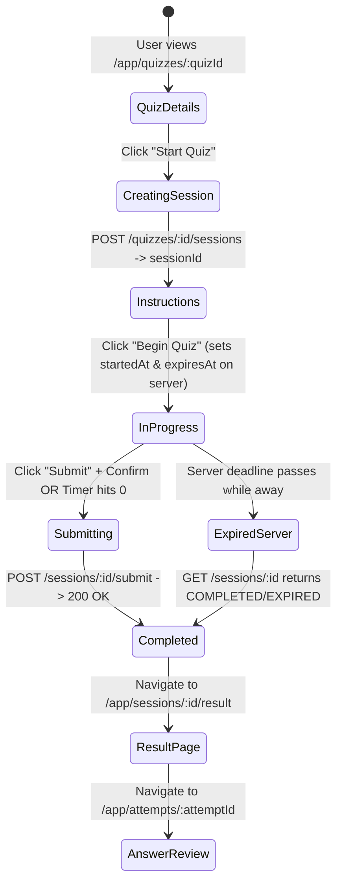

# Frontend Page Specifications & Core UX Workflows

> **Document Status:** Architectural Blueprint (Pre-Implementation)
> **Covers:** All 34 routes + Deep Dives on Quiz-Taking UX, AI Generator UX, and Analytics Charts

---

## 1. Deep-Dive: Quiz-Taking User Experience (Core Product Flow)

The quiz-taking workflow spans three dedicated routes: `/app/sessions/:sessionId/instructions`, `/app/sessions/:sessionId/play`, and `/app/sessions/:sessionId/result` (plus `/app/attempts/:attemptId` for full review).

### 1.1 Session & Question Lifecycle State Machine

### 1.2 Step-by-Step Workflow

1. **Quiz Instructions (`/app/sessions/:sessionId/instructions`):**
   - Displays quiz title, category, difficulty, total questions, total duration, passing threshold (if configured), question types (Single Choice / Multiple Choice), and rules (timer continues server-side on refresh; answers auto-save).
   - **Resume Intelligence:** If `session.status === 'IN_PROGRESS'`, button reads `"Resume Quiz"` with remaining time shown; if `SUBMITTED`/`EXPIRED`, immediately redirects to `/app/sessions/:sessionId/result`.
2. **Start Quiz & Session Creation:**
   - Triggered from Quiz Details (`/app/quizzes/:quizId`) via `POST /api/v1/quizzes/:quizId/sessions`.
   - If the backend detects an already active `IN_PROGRESS` session for `(userId, quizId)` (single active session policy), it returns that existing `sessionId` rather than creating duplicates.
3. **Question Display & Answer Selection (`/app/sessions/:sessionId/play`):**
   - Full-screen `QuizRunnerLayout` removes sidebar/footer.
   - Displays 1 question at a time (`Question X of N`), question text, optional code/context block (escaped plain text / safe code fence), and selectable option cards (`A`, `B`, `C`, `D`...) with radio (`SINGLE_CHOICE`) or checkbox (`MULTIPLE_CHOICE`) semantics.
   - Selecting an option updates local state immediately (optimistic UI) and triggers a debounced/immediate `PUT /api/v1/sessions/:sessionId/answers` save.
4. **Question States (4 Explicit States):**
   - `NOT_VISITED`: User has not navigated to this question yet (tracked client-side + hydrated from whether an answer exists on reload).
   - `VISITED_UNANSWERED`: User viewed the question but has not selected any option (or cleared their selection).
   - `ANSWERED`: At least one option is selected (persisted or queued for save).
   - `MARKED_FOR_REVIEW`: User toggled `"Mark for Review"` flag (can orthogonally apply to `VISITED_UNANSWERED` or `ANSWERED`). Persisted in `sessionStorage` keyed by `sessionId` (and synced to backend if backend adds a `marked` flag).
5. **Question Navigation & Progress Indicator:**
   - `Previous` / `Next` buttons, direct jump via Question Palette grid (`1..N`), and top linear progress bar (`answeredCount / totalQuestions`).
6. **Authoritative Countdown Timer:**
   - **Never trust `Date.now()` alone.** Compute `clockSkewMs = new Date(session.serverNow).getTime() - Date.now()` on session fetch.
   - Compute `remainingMs = new Date(session.expiresAt).getTime() - (Date.now() + clockSkewMs)`.
   - Visual thresholds: Normal (`slate`), Warning (`<= 5 min` amber), Critical (`<= 60 sec` rose + polite screen-reader announcement).
7. **Submit Confirmation & Auto-Submission:**
   - Clicking `"Finish Quiz"` opens `SubmitQuizModal` showing counts of `Answered`, `Unanswered`, and `Marked for Review` questions.
   - When `remainingMs <= 0`, the frontend locks all answer inputs, displays `"Time Expired — Submitting your answers..."`, flushes any pending buffered answer, and calls `POST /api/v1/sessions/:sessionId/submit` automatically.
8. **Result & Answer Review:**
   - Redirects to `/app/sessions/:sessionId/result` (`replace: true` so browser Back doesn't re-enter the finished quiz).
   - Users then drill into `/app/attempts/:attemptId` to see correct answers and explanations (never returned by the backend until `status !== 'IN_PROGRESS'`).

### 1.3 Resilience & Edge-Case Behavior Matrix

| Edge Case | Frontend Behavior |
|---|---|
| **User refreshes the page** | `QuizPlayPage` fetches `GET /api/v1/sessions/:sessionId`. Server returns persisted answers, `serverNow`, and `expiresAt`. Local `markedForReview` and last `currentQuestionIndex` are restored from `sessionStorage` (`quiz_ui_<sessionId>`). |
| **Internet connection drops** | `useOnlineStatus` + failed `PUT /answers` shows subtle `"Offline — answers queued locally"` amber pill in top bar. Unsynced answers remain in an in-memory + `sessionStorage` retry queue and automatically flush sequentially once connectivity returns. Submit button warns if unsynced answers haven't flushed yet and attempts flush before submit. |
| **Session expires on server (`410 Gone` / `409 Conflict` / `SESSION_EXPIRED`)** | Lock UI immediately, display `"Your quiz session has expired"`, automatically refetch session/attempt summary, and navigate to `/app/sessions/:sessionId/result`. |
| **Backend rejects an answer (`400`/`422`/`409`)** | Roll back optimistic answer for that `questionId` to last confirmed server value, show non-blocking Toast explaining rejection, and if `409 SESSION_NOT_ACTIVE`, trigger session status resync. |
| **User clicks Submit twice / double-submit** | Disable submit button immediately via `submitMutation.isPending` + ref guard (`isSubmittingRef`), send `Idempotency-Key` header, and treat `409 ALREADY_SUBMITTED` as success -> navigate to `/result`. |
| **Timer reaches zero** | Clear interval, disable option inputs, flush pending answer queue (best effort with 2s timeout), call `submit` once. If offline at `00:00`, show blocking `"Connection lost at deadline — retrying submission..."` modal with manual Retry button while keeping queued answers intact. |
| **Multiple tabs open same session** | Use `BroadcastChannel('quiz-session-' + sessionId)`: when a new tab opens the session, notify older tab(s) and display a `"Session active in another tab — Switch / Take Over here"` overlay on the inactive tab to prevent conflicting answer overwrites. |

---

## 2. Deep-Dive: AI Quiz Generator Experience

Route: `/app/ai/generate`

### 2.1 Workflow & State Transitions

1. **Configuration Form:**
   - Inputs: `Topic / Prompt` (required, 3–300 chars), `Category` (select), `Difficulty` (`EASY`, `MEDIUM`, `HARD`), `Question Count` (stepper/slider e.g. `5`, `10`, `15`, `20`), `Duration (minutes)` (auto-suggested from count, editable), `Additional Instructions` (optional textarea, e.g., *"Focus on Spring Boot 4 security filters and avoid trivia"*).
2. **Async Generation & Progress State:**
   - Submitting calls `POST /api/v1/ai/quizzes/generate` (with `Idempotency-Key`) which returns `{ jobId, status: "PENDING" | "PROCESSING" }` (`202 Accepted`)—or synchronous draft if backend opts for direct response, handled behind a unified adapter.
   - UI transitions to a **Generation Progress View** showing staged feedback (*"Analyzing topic..." -> "Drafting questions..." -> "Validating options..."*), elapsed time, Cancel/Reset option, and polling `GET /api/v1/ai/jobs/:jobId` every `2s` (with timeout fallback at e.g. `90s`).
3. **Failure & Retry:**
   - If job returns `FAILED` (provider timeout, invalid JSON, safety block, rate limit `429`), retain all user form inputs untouched, display clear `Alert` with error reason, and provide `"Retry Generation"` and `"Edit Prompt"` actions.
4. **Interactive Draft Review & Editing:**
   - Once `COMPLETED`, render the generated quiz title, description, and editable question cards:
     - **Edit Question:** Inline edit stem, options, correct option(s), and explanation.
     - **Remove Question:** Delete weak questions (with warning if below minimum 1 question).
     - **Regenerate Single Question:** Per-card `"Regenerate"` button calls `POST /api/v1/ai/jobs/:jobId/questions/:index/regenerate` with spinner isolated to that single card so other edits aren't lost.
5. **Preview & Save/Publish:**
   - `"Preview Quiz"` modal lets creator step through questions as a test-taker would.
   - `"Save as Draft"` (`POST /api/v1/quizzes` with `status: 'DRAFT'`) or `"Save & Publish"` (`status: 'PUBLISHED'`), then redirects to `/app/quizzes/:quizId`.

---

## 3. Deep-Dive: Dashboard & Analytics (Recharts)

Routes: `/app/dashboard` and `/app/analytics`

> [!IMPORTANT]
> Charts strictly map to standard quiz attempt aggregations. Do **not** invent unrequested metrics (e.g., percentile ranking vs peers if backend doesn't compute it).

| Chart / Widget | Location | Recharts Type | Required Backend Data | Empty State | Loading State | Tooltip Info | Mobile Layout |
|---|---|---|---|---|---|---|---|
| **KPI Summary Strip** (4 cards) | Dashboard & Analytics | Custom `StatCard` (no chart) | `totalAttempts`, `completedAttempts`, `averageScorePercent`, `bestScorePercent` | `"0 attempts yet — Take your first quiz"` | 4 rectangular `Skeleton` cards | N/A | 2x2 grid (`<640px`: 1 col or 2x2 compact) |
| **Performance Trend Over Time** | Dashboard (compact) & Analytics (full) | `ResponsiveContainer` + `AreaChart` / `LineChart` | `Array<{ dateLabel, attemptCount, averageScorePercent }>` | Dashed placeholder + `"Complete 2+ quizzes to see your score trend"` CTA | Chart-sized pulsing rectangle with axis lines | Date, Avg Score (`%`), Attempts that day | Reduced X-axis ticks (`interval="preserveStartEnd"`), height `220px` |
| **Category-Wise Performance** | Analytics | `ResponsiveContainer` + `BarChart` (horizontal on mobile) | `Array<{ categoryName, attemptCount, averageScorePercent }>` | `"No category data yet"` | Horizontal skeleton bars | Category name, Avg Score (`%`), Quizzes completed | Switches to vertical-axis horizontal bars (`layout="vertical"`) for readable labels |
| **Difficulty-Wise Performance** | Analytics | `ResponsiveContainer` + `BarChart` (grouped or colored bars) | `Array<{ difficulty: 'EASY'\|'MEDIUM'\|'HARD', attemptCount, averageScorePercent, passRatePercent }>` | `"Attempt quizzes across difficulties to compare performance"` | 3 vertical skeleton bars | Difficulty, Avg Score (`%`), Attempt count | Compact 3-bar view (`height: 220px`) |

---

## 4. Complete Page-by-Page Specifications

### Group A: Public & Authentication Pages

#### 1. Landing Page — `/`
- **Access:** Public (authenticated users see `"Go to Dashboard"` in navbar instead of Login/Register).
- **Purpose:** Communicate platform value, showcase AI + manual quiz creation and analytics, and convert visitors.
- **Main Features & UI Sections:** Hero section with primary CTAs (`Explore Quizzes`, `Create Free Account`), 3-column core workflow (`Generate with AI`, `Interactive Timed Runner`, `Track Progress`), Featured Public Quizzes preview (or static sample categories if backend unavailable), Footer.
- **Reusable Components:** `PublicNavbar`, `PublicFooter`, `Button`, `QuizCard`, `Badge`.
- **Required APIs:** Optional `GET /api/v1/public/quizzes?limit=6`.
- **Interactions:** Click CTA -> `/register` or `/explore`; click featured quiz -> `/explore/:quizId`.
- **States:** *Loading:* 3 card skeletons for featured quizzes. *Empty:* Hide featured grid or show static category highlights gracefully. *Error:* Fail silently for optional featured preview without breaking landing page. *Success:* Full page rendered.
- **Responsive:** Hero stacks image/preview below copy on `<1024px`; feature grid 3 cols -> 1 col.

#### 2. Public Quiz Discovery — `/explore`
- **Access:** Public.
- **Purpose:** Search and filter published public quizzes.
- **Main Features & UI Sections:** Search bar, Category & Difficulty filter bar, Sort dropdown (`Newest`, `Most Popular`), Quiz Card Grid, Pagination.
- **Reusable Components:** `SearchInput`, `FilterBar`, `QuizCard`, `Pagination`, `Skeleton`, `EmptyState`.
- **Required APIs:** `GET /api/v1/public/quizzes`, `GET /api/v1/categories`.
- **Interactions:** Typing updates debounced `?q=` URL param; filter changes reset `?page=1`.
- **States:** *Loading:* 6–9 `QuizCardSkeleton`s. *Empty:* `"No quizzes match your filters"` + `"Clear Filters"` button. *Error:* `ErrorState` banner with `"Retry"` button. *Success:* Paginated grid.
- **Responsive:** Filters collapse into `"Filters"` drawer/accordion on mobile; grid 3 cols -> 2 cols -> 1 col.

#### 3. Public Quiz Details — `/explore/:quizId`
- **Access:** Public.
- **Purpose:** Preview quiz scope before logging in or starting.
- **Main Features & UI Sections:** Breadcrumb (`Explore / Quiz`), Title, Description, Difficulty/Category badges, Metadata stats (`Questions`, `Duration`, `Author`), Sign-in/Start CTA card.
- **Reusable Components:** `PageHeader`, `Badge`, `Card`, `Button`, `Alert`, `Skeleton`.
- **Required APIs:** `GET /api/v1/public/quizzes/:quizId`.
- **Interactions:** Guest clicks `"Sign in to Start"` -> navigates to `/login?redirect=/app/quizzes/:quizId`; signed-in user navigates directly to `/app/quizzes/:quizId`.
- **States:** *Loading:* Detail skeleton. *Empty/404:* `"Quiz not found or no longer public"` + link back to `/explore`. *Error:* Retry banner. *Success:* Quiz metadata card.
- **Responsive:** 2-column layout (details left, sticky CTA summary right) stacks to 1 column on `<1024px`.

#### 4. About Page — `/about`
- **Access:** Public.
- **Purpose:** Present platform mission, educational approach, and how AI generation works responsibly.
- **Main Features & UI Sections:** Mission header, `"How It Works"` 3-step cards, Quality & Fairness principles (server-authoritative timing, transparent scoring).
- **Reusable Components:** `Card`, `PageHeader`, `Button`.
- **Required APIs:** None.
- **States:** Static content (no loading/error states; instant render).
- **Responsive:** Multi-column value cards stack to 1 column on mobile.

#### 5. Contact Page — `/contact`
- **Access:** Public.
- **Purpose:** Support and feedback submission.
- **Main Features & UI Sections:** Contact info panel + validated inquiry form (`Name`, `Email`, `Topic`, `Message`).
- **Reusable Components:** `Input`, `Textarea`, `Select`, `Button`, `Alert`.
- **Required APIs:** `POST /api/v1/public/contact` (PROPOSED; fallback: clear support email link if endpoint deferred).
- **Interactions:** Form submit validates via Zod, disables button while sending.
- **States:** *Loading:* Button spinner. *Empty:* Default blank form. *Error:* Inline error alert preserving inputs. *Success:* Confirmation card with `"Send another message"`.
- **Responsive:** Side-by-side info + form stacks vertically on `<768px`.

#### 6. Privacy Policy — `/privacy` & 7. Terms & Conditions — `/terms`
- **Access:** Public.
- **Purpose:** Legal compliance pages linked from footer and registration form.
- **Main Features & UI Sections:** Sticky table of contents (desktop), readable prose sections (`max-w-3xl`), effective date badge.
- **Reusable Components:** `Badge`, prose typography container.
- **Required APIs:** None.
- **States:** Static render.
- **Responsive:** TOC collapses to top anchor list on `<1024px`.

#### 8. Login Page — `/login`
- **Access:** Guest only (`RequireGuest`).
- **Purpose:** Authenticate user and restore intended destination.
- **Main Features & UI Sections:** Auth card (`AuthLayout`), Email & Password inputs (with visibility toggle), `"Forgot password?"` link, Submit button, `"Create account"` link.
- **Reusable Components:** `AuthCard`, `FormField`, `Input`, `PasswordInput`, `Button`, `Alert`.
- **Required APIs:** `POST /api/v1/auth/login`.
- **Interactions:** Submit validates locally -> calls login -> stores access token in memory -> redirects to safe `?redirect` path or `/app/dashboard`.
- **States:** *Loading:* Submit button disabled + spinner. *Error:* `401` displays inline `"Invalid email or password"`; `429` shows rate-limit cooldown message. *Success:* Immediate redirect.
- **Responsive:** Centered `420px` card on desktop/tablet; full-width padded form on mobile.

#### 9. Registration Page — `/register`
- **Access:** Guest only (`RequireGuest`).
- **Purpose:** Self-service account creation.
- **Main Features & UI Sections:** Full Name / Display Name, Email, Password + live strength indicator, Confirm Password, Terms/Privacy agreement checkbox, Submit CTA.
- **Reusable Components:** `AuthCard`, `FormField`, `PasswordStrengthMeter`, `Checkbox`, `Button`, `Alert`.
- **Required APIs:** `POST /api/v1/auth/register`.
- **Interactions:** Real-time password strength hint; inline field validation on blur/submit.
- **States:** *Loading:* Disabled button + spinner. *Error:* `409 Conflict` maps cleanly to `"An account with this email already exists"`; `400` maps field errors. *Success:* Auto-login (if token returned) -> `/app/dashboard`, or `"Account created"` -> `/login`.
- **Responsive:** Same responsive card layout as Login.

#### 10. Forgot Password — `/forgot-password`
- **Access:** Guest only.
- **Purpose:** Request password reset link.
- **Main Features & UI Sections:** Email input, Submit CTA, Back to login link.
- **Reusable Components:** `AuthCard`, `FormField`, `Button`, `Alert`.
- **Required APIs:** `POST /api/v1/auth/forgot-password`.
- **Interactions:** Submit triggers email request.
- **States:** *Loading:* Spinner. *Error:* Network/rate-limit error only. *Success:* Always displays neutral security message: *"If an account exists for that email, reset instructions have been sent."*
- **Responsive:** Centered mobile-friendly auth card.

#### 11. Reset Password — `/reset-password`
- **Access:** Guest only (requires `?token=` query parameter).
- **Purpose:** Set a new password using a reset token.
- **Main Features & UI Sections:** New Password, Confirm Password, Submit CTA; invalid/missing token fallback screen.
- **Reusable Components:** `AuthCard`, `PasswordInput`, `PasswordStrengthMeter`, `Button`, `Alert`.
- **Required APIs:** `POST /api/v1/auth/reset-password`.
- **Interactions:** Reads `token` from `useSearchParams()`.
- **States:** *Empty/Missing Token:* Show `"Invalid or missing reset link"` + link to `/forgot-password`. *Loading:* Spinner. *Error:* Expired/used token alert with link to request a new one. *Success:* Confirmation + `"Sign in with new password"` CTA -> `/login`.
- **Responsive:** Centered auth card.

---

### Group B: Authenticated User Pages

#### 12. Dashboard — `/app/dashboard`
- **Access:** Authenticated (`USER`, `ADMIN`).
- **Purpose:** Personal command center summarizing progress and launching next actions.
- **Main Features & UI Sections:** Greeting header + Quick Action buttons (`Generate with AI`, `Create Quiz`, `Explore`), 4 KPI `StatCard`s, Performance Trend `AreaChart`, Recent Attempts list (latest 5), Recommended/Popular Quizzes strip (if backend supports).
- **Reusable Components:** `PageHeader`, `StatCard`, `ChartContainer`, `AttemptStatusBadge`, `QuizCard`, `Skeleton`, `EmptyState`.
- **Required APIs:** `GET /api/v1/analytics/summary`, `GET /api/v1/attempts?limit=5`, `GET /api/v1/quizzes?limit=4&sort=popular`.
- **Interactions:** Click recent attempt -> `/app/attempts/:attemptId`; click quick action -> `/app/ai/generate` or `/app/quizzes/create`.
- **States:** *Loading:* KPI skeletons + chart skeleton + list skeleton. *Empty (New User):* Onboarding card `"Welcome! Take a quiz or generate one with AI to start tracking your progress."` *Error:* Per-widget error state with retry (analytics failure must not crash recent attempts). *Success:* Populated dashboard.
- **Responsive:** 4-col KPIs -> 2-col tablet -> 1/2-col mobile; 2-col main split (Chart + Recent Attempts) stacks on `<1024px`.

#### 13. My Quizzes & Quiz Library — `/app/quizzes`
- **Access:** Authenticated (`USER`, `ADMIN`).
- **Purpose:** Discover all accessible quizzes and manage user-authored quizzes.
- **Main Features & UI Sections:** Tabs (`All Quizzes`, `My Quizzes`), Search & Filters (Category, Difficulty, Status on My Quizzes: `ALL`/`DRAFT`/`PUBLISHED`/`ARCHIVED`), `"Create Quiz"` & `"Generate with AI"` CTAs, Quiz Grid/Table, Row/Card actions (`View`, `Edit`, `Publish/Unpublish`, `Delete`).
- **Reusable Components:** `PageHeader`, `Tabs`, `FilterBar`, `QuizCard`, `ConfirmDialog`, `Pagination`, `EmptyState`.
- **Required APIs:** `GET /api/v1/quizzes`, `GET /api/v1/quizzes/mine`, `GET /api/v1/categories`, `PATCH /api/v1/quizzes/:quizId/status`, `DELETE /api/v1/quizzes/:quizId`.
- **Interactions:** Switching tabs syncs `?tab=mine`; delete requires `ConfirmDialog`.
- **States:** *Loading:* 6 card skeletons. *Empty:* Context-aware (`"You haven't created any quizzes yet"` with Create + AI Generate buttons). *Error:* Retry banner. *Success:* Interactive catalog + toast on status/delete.
- **Responsive:** Tab bar scrollable horizontally on mobile; 3-col grid -> 2-col -> 1-col.

#### 14. Create Quiz (Manual) — `/app/quizzes/create`
- **Access:** Authenticated (`USER`, `ADMIN`).
- **Purpose:** Author a complete quiz manually with metadata and questions.
- **Main Features & UI Sections:** Two-part editor: (1) Quiz Metadata (`Title`, `Description`, `Category`, `Difficulty`, `Duration Minutes`, `Visibility/Status`), (2) Dynamic Question Builder (`Add Question`, `Question Type`, `Question Text`, `2–6 Options`, `Correct Answer selector`, `Optional Explanation`, `Move Up/Down`, `Duplicate`, `Remove`). Sticky bottom/top action bar (`Save as Draft`, `Publish Quiz`).
- **Reusable Components:** `PageHeader`, `QuizMetadataForm`, `QuestionBuilderList`, `QuestionEditorCard`, `Button`, `Alert`, `ConfirmDialog` (unsaved changes guard).
- **Required APIs:** `GET /api/v1/categories`, `POST /api/v1/quizzes`.
- **Interactions:** Client-side Zod validation ensures >= 1 question, >= 2 non-empty options per question, and >= 1 marked correct answer; warns on route leave if dirty.
- **States:** *Loading (Categories):* Form skeleton. *Error:* Server validation mapped to specific fields/questions + top summary alert. *Success:* Toast + redirect to `/app/quizzes/:quizId`.
- **Responsive:** Question list & metadata stack cleanly; option inputs wrap action icons cleanly on `<640px`.

#### 15. Quiz Details — `/app/quizzes/:quizId`
- **Access:** Authenticated (`USER`, `ADMIN`).
- **Purpose:** Inspect quiz details, view personal past attempts on this quiz, and start an attempt.
- **Main Features & UI Sections:** Quiz Header + Badges, Metadata summary (`Questions`, `Duration`, `Difficulty`, `Creator`), Primary `"Start Quiz"` (or `"Resume Active Session"`), Secondary links (`View Quiz Leaderboard`, `Edit Quiz` if owner), Personal Attempt History table for this quiz.
- **Reusable Components:** `PageHeader`, `Badge`, `StatCard`, `DataTable`, `Button`, `EmptyState`.
- **Required APIs:** `GET /api/v1/quizzes/:quizId`, `GET /api/v1/attempts?quizId=:quizId`, `POST /api/v1/quizzes/:quizId/sessions`.
- **Interactions:** Clicking `"Start Quiz"` creates/resumes session -> navigates to `/app/sessions/:sessionId/instructions`.
- **States:** *Loading:* Page skeleton. *Empty (no personal attempts):* `"You haven't taken this quiz yet"`. *Error:* 404/403 or network error with retry. *Success:* Full details + start button.
- **Responsive:** Action panel moves above past attempts on mobile.

#### 16. Edit Quiz — `/app/quizzes/:quizId/edit`
- **Access:** Authenticated (Quiz Owner or `ADMIN`).
- **Purpose:** Update quiz metadata and questions.
- **Main Features & UI Sections:** Same structured editor as Create Quiz, pre-populated with existing quiz & questions, plus Publish/Unpublish/Archive status controls and warning banner if quiz already has completed attempts (clarifying impact on historical attempts).
- **Reusable Components:** `QuizMetadataForm`, `QuestionBuilderList`, `Alert`, `ConfirmDialog`, `Skeleton`.
- **Required APIs:** `GET /api/v1/quizzes/:quizId/manage`, `PUT /api/v1/quizzes/:quizId`, `PATCH /api/v1/quizzes/:quizId/status`, `GET /api/v1/categories`.
- **Interactions:** Dirty-form protection; save sends full updated payload (or diff depending on backend contract).
- **States:** *Loading:* Editor skeleton. *Error:* `403` redirects/shows unauthorized; save errors inline. *Success:* Toast + stay or view quiz.
- **Responsive:** Same as Create Quiz.

#### 17. Quiz-Specific Leaderboard — `/app/quizzes/:quizId/leaderboard`
- **Access:** Authenticated (`USER`, `ADMIN`).
- **Purpose:** Rank participants on a specific quiz by score and completion time.
- **Main Features & UI Sections:** Quiz summary header, Current User's Best Rank highlight card, Ranked `DataTable` (`Rank`, `Player`, `Best Score %`, `Time Taken`, `Attempt Date`), Pagination.
- **Reusable Components:** `PageHeader`, `DataTable`, `RankBadge`, `Avatar`, `Pagination`, `EmptyState`.
- **Required APIs:** `GET /api/v1/leaderboards/quizzes/:quizId`, `GET /api/v1/quizzes/:quizId`.
- **States:** *Loading:* Table row skeletons. *Empty:* `"No completed attempts on this quiz yet — be the first!"` + `"Take Quiz"` CTA. *Error:* Retry state. *Success:* Highlighted user row + sorted rankings.
- **Responsive:** Table collapses to ranked mobile cards showing Rank # + Avatar + Score + Time.

#### 18. AI Quiz Generator — `/app/ai/generate`
- **Access:** Authenticated (`USER`, `ADMIN`).
- **Purpose:** Configure AI parameters, monitor generation job, edit generated questions, and save/publish.
- **Main Features & UI Sections:** Split or multi-step flow: (1) Generator Config Form, (2) Async Job Progress / Failure-Retry Panel, (3) Draft Question Preview & Inline Editor with per-question Regenerate/Delete, (4) Preview Modal & Save Draft / Publish bar.
- **Reusable Components:** `AiConfigForm`, `AiJobProgressCard`, `GeneratedQuestionCard`, `QuizPreviewModal`, `Button`, `Alert`.
- **Required APIs:** `GET /api/v1/categories`, `POST /api/v1/ai/quizzes/generate`, `GET /api/v1/ai/jobs/:jobId`, `POST /api/v1/ai/jobs/:jobId/questions/:index/regenerate`, `POST /api/v1/quizzes`.
- **States:** *Loading/Generating:* Animated progress steps + cancel option. *Empty (Initial):* Helpful prompt examples (chips like *"Spring Security JWT"*, *"PostgreSQL Indexing"*). *Error:* Rate limit / AI failure alert retaining prompt for 1-click retry. *Success:* Editable generated quiz -> redirects to `/app/quizzes/:quizId` on save.
- **Responsive:** 2-column (config left, output right) on `>=1024px` collapses to stacked single-column flow on tablet/mobile.

#### 19. Quiz Instructions — `/app/sessions/:sessionId/instructions`
- **Access:** Authenticated (Session Owner).
- **Purpose:** Present rules and confirm readiness before starting/resuming timer.
- **Main Features & UI Sections:** Quiz title, duration/question/scoring summary cards, instruction checklist, `"Begin Quiz"` / `"Resume Quiz"` button, `"Back to Quiz"` link.
- **Reusable Components:** `Card`, `StatCard`, `Alert`, `Button`, `Skeleton`.
- **Required APIs:** `GET /api/v1/sessions/:sessionId`, `POST /api/v1/sessions/:sessionId/begin` (if pre-start state exists).
- **States:** *Loading:* Centered card skeleton. *Error:* 404/403/expired redirect handling. *Success:* Ready-to-start screen.
- **Responsive:** Centered `max-w-2xl` card across all viewports.

#### 20. Interactive Quiz Runner — `/app/sessions/:sessionId/play`
- **Access:** Authenticated (Session Owner).
- **Purpose:** Deliver distraction-free timed quiz experience (detailed in Section 1 above).
- **Main Features & UI Sections:** `QuizRunnerLayout` top header (Title, `Question X/N`, `CountdownTimer`, Save status pill, `Finish`), Question Stage (`QuestionStem`, `OptionList`, `Mark for Review`, `Prev`/`Next`), Question Palette (`Not visited` / `Visited` / `Answered` / `Marked`), `SubmitQuizModal`, Multi-tab conflict overlay.
- **Reusable Components:** `CountdownTimer`, `QuestionPalette`, `OptionCard`, `ConfirmDialog`, `Alert`.
- **Required APIs:** `GET /api/v1/sessions/:sessionId`, `PUT /api/v1/sessions/:sessionId/answers`, `POST /api/v1/sessions/:sessionId/submit`.
- **States:** *Loading:* Full-screen runner skeleton. *Error:* Inline network-offline retry pill; session expired auto-redirect. *Success:* Navigates to `/app/sessions/:sessionId/result`.
- **Responsive:** Desktop split pane (70% question / 30% palette); Mobile full-width question + bottom sticky `Prev / Palette Drawer / Next` bar.

#### 21. Quiz Result — `/app/sessions/:sessionId/result`
- **Access:** Authenticated (Session Owner).
- **Purpose:** Immediate feedback after submission.
- **Main Features & UI Sections:** Score ring/percentage headline, Pass/Fail or performance badge, Breakdown KPIs (`Correct`, `Incorrect`, `Unanswered`, `Time Taken`), Primary CTAs (`Review Detailed Answers` -> `/app/attempts/:attemptId`, `View Leaderboard`, `Retake Quiz`, `Back to Dashboard`).
- **Reusable Components:** `Card`, `StatCard`, `Badge`, `ProgressBar`, `Button`.
- **Required APIs:** `GET /api/v1/sessions/:sessionId/result`.
- **States:** *Loading:* Result card skeleton (handles brief `"Grading in progress..."` poll if async). *Error:* Retry load button. *Success:* Complete score summary.
- **Responsive:** KPI breakdown 4 cols -> 2x2 grid on mobile; CTAs stack vertically on mobile.

#### 22. Attempt History — `/app/attempts`
- **Access:** Authenticated (`USER`, `ADMIN`).
- **Purpose:** Browse and filter all past and in-progress quiz attempts.
- **Main Features & UI Sections:** Search by quiz title, Status filter (`ALL`, `COMPLETED`, `EXPIRED`, `IN_PROGRESS`), Date sort, `DataTable` (`Quiz`, `Category`, `Score`, `Duration`, `Status`, `Date`, `Action`: `Review` or `Resume`), Pagination.
- **Reusable Components:** `PageHeader`, `SearchInput`, `FilterBar`, `DataTable`, `Badge`, `Pagination`, `EmptyState`.
- **Required APIs:** `GET /api/v1/attempts`.
- **States:** *Loading:* Table skeleton rows. *Empty:* `"No quiz attempts yet"` + `"Explore Quizzes"` CTA. *Error:* Retry banner. *Success:* Paginated attempt history.
- **Responsive:** Converts table rows to clean summary cards on `<768px`.

#### 23. Attempt Details & Answer Review — `/app/attempts/:attemptId`
- **Access:** Authenticated (Attempt Owner or `ADMIN`).
- **Purpose:** Question-by-question post-quiz learning review.
- **Main Features & UI Sections:** Summary header (`Score`, `Correct/Total`, `Time Taken`, `Completed At`), Filter pills (`All Questions`, `Incorrect Only`, `Correct Only`, `Unanswered`), Question Review Cards showing prompt, all options with clear indicators (`Your Answer` vs `Correct Answer`), and AI/Author `Explanation` box.
- **Reusable Components:** `PageHeader`, `StatCard`, `Tabs`, `AnswerReviewCard`, `Badge`, `EmptyState`.
- **Required APIs:** `GET /api/v1/attempts/:attemptId`.
- **States:** *Loading:* Header + 3 review card skeletons. *Empty (e.g., `Incorrect Only` filter with 100% score):* `"Perfect score! No incorrect answers to review."` *Error:* 403/404 or retry. *Success:* Detailed review list.
- **Responsive:** Single-column `max-w-4xl` stack with clear option badges on mobile.

#### 24. Performance Analytics — `/app/analytics`
- **Access:** Authenticated (`USER`, `ADMIN`).
- **Purpose:** Deep-dive personal analytics (detailed in Section 3 above).
- **Main Features & UI Sections:** Date range selector (`7d`, `30d`, `90d`, `All`), 4 KPI cards, Performance Trend chart, Category-wise chart, Difficulty-wise chart.
- **Reusable Components:** `PageHeader`, `StatCard`, `ChartContainer`, `Tabs`, `Skeleton`, `EmptyState`.
- **Required APIs:** `GET /api/v1/analytics/overview`, `GET /api/v1/analytics/trends`, `GET /api/v1/analytics/by-category`, `GET /api/v1/analytics/by-difficulty`.
- **States:** *Loading / Empty / Error / Success:* Defined per chart in Section 3.
- **Responsive:** Charts stack 1-per-row on `<1024px`; mobile bar chart switches to horizontal bars.

#### 25. Global Leaderboard — `/app/leaderboard`
- **Access:** Authenticated (`USER`, `ADMIN`).
- **Purpose:** Platform-wide rankings across all users.
- **Main Features & UI Sections:** Timeframe tabs (`Weekly`, `Monthly`, `All Time`), Top 3 podium/highlight strip (clean card layout), Current User Rank banner, Paginated `DataTable` (`Rank`, `User`, `Quizzes Completed`, `Avg Score`, `Total Points`).
- **Reusable Components:** `PageHeader`, `Tabs`, `DataTable`, `Avatar`, `RankBadge`, `Pagination`, `EmptyState`.
- **Required APIs:** `GET /api/v1/leaderboards/global`.
- **States:** *Loading:* Top cards + table skeleton. *Empty:* `"Leaderboard data is empty for this timeframe."` *Error:* Retry alert. *Success:* Highlighted user row + paginated table.
- **Responsive:** Top 3 cards stack 1-col on mobile; table switches to ranked mobile rows.

#### 26. User Profile — `/app/profile`
- **Access:** Authenticated (`USER`, `ADMIN`).
- **Purpose:** Manage personal display profile and view account overview.
- **Main Features & UI Sections:** Avatar/initials card + role badge + member since date, Editable profile form (`Display Name`, `Bio`, read-only `Email` / `Role`), Personal lifetime summary stats.
- **Reusable Components:** `PageHeader`, `Avatar`, `FormField`, `Input`, `Textarea`, `Button`, `StatCard`.
- **Required APIs:** `GET /api/v1/users/me`, `PATCH /api/v1/users/me`.
- **States:** *Loading:* Form skeleton. *Error:* Field validation / conflict alert. *Success:* Toast `"Profile updated"` + updates `AuthProvider` user state.
- **Responsive:** 2-column (Identity summary left, Form right) stacks to 1 column on `<1024px`.

#### 27. Account Settings — `/app/settings`
- **Access:** Authenticated (`USER`, `ADMIN`).
- **Purpose:** Security settings (password change) and workspace preferences (theme, timer display prefs).
- **Main Features & UI Sections:** Security section (`Current Password`, `New Password`, `Confirm New Password`), Appearance/Preferences section (`Theme: System / Light / Dark`), Session sign-out action.
- **Reusable Components:** `PageHeader`, `Card`, `PasswordInput`, `Select`, `Button`, `Alert`.
- **Required APIs:** `PUT /api/v1/users/me/password`, `GET /api/v1/users/me/preferences` (optional), `PATCH /api/v1/users/me/preferences` (optional).
- **States:** *Loading:* Form skeleton. *Error:* Wrong current password -> inline error on `Current Password`. *Success:* Toast `"Password updated"` + resets password fields.
- **Responsive:** Vertical card stack (`max-w-3xl`).

---

### Group C: Administrator Pages (Conditional on Backend `ROLE_ADMIN`)

#### 28. Admin Dashboard — `/admin`
- **Access:** `ADMIN` role only.
- **Purpose:** High-level platform KPIs and moderation queue entry points.
- **Main Features & UI Sections:** KPI strip (`Total Users`, `Published Quizzes`, `Attempts Today`, `AI Jobs 24h`), Recent AI failures summary, Quick links to Users/Moderation/Categories.
- **Required APIs:** `GET /api/v1/admin/analytics/overview` (PROPOSED).
- **States:** Loading skeletons, Empty, 403/Network Error, Success.
- **Responsive:** 4-col -> 2-col -> 1-col.

#### 29. User Management — `/admin/users`
- **Access:** `ADMIN` role only.
- **Purpose:** Search users, inspect roles/status, suspend/reactivate accounts.
- **Main Features & UI Sections:** Search + Role/Status filters, User `DataTable`, Action modal/confirm for status or role changes (preventing self-demotion/self-suspension).
- **Required APIs:** `GET /api/v1/admin/users`, `PATCH /api/v1/admin/users/:userId/status`, `PATCH /api/v1/admin/users/:userId/roles` (PROPOSED).
- **States:** Table skeletons, Empty search state, Error toast/banner, Optimistic/confirmed status badge update.
- **Responsive:** Mobile stacked user cards with action menu.

#### 30. Quiz Moderation — `/admin/quizzes`
- **Access:** `ADMIN` role only.
- **Purpose:** Audit public/AI quizzes and unpublish/archive policy-violating content.
- **Main Features & UI Sections:** Filterable Quiz table (`Status`, `AI-Generated`, `Creator`), Slide-over preview drawer to read questions, Unpublish/Approve/Archive confirmation modal with optional reason.
- **Required APIs:** `GET /api/v1/admin/quizzes`, `PATCH /api/v1/admin/quizzes/:quizId/moderation` (PROPOSED).
- **States:** Skeleton, Empty queue, Error, Success toast.
- **Responsive:** Preview drawer becomes full-screen modal on mobile.

#### 31. Category Management — `/admin/categories`
- **Access:** `ADMIN` role only.
- **Purpose:** Create, rename, and activate/deactivate standardized quiz categories.
- **Main Features & UI Sections:** `"Add Category"` modal, Categories table with quiz count and active toggle, Safe delete/deactivate confirmation.
- **Required APIs:** `GET /api/v1/categories`, `POST /api/v1/admin/categories`, `PUT /api/v1/admin/categories/:id`, `DELETE /api/v1/admin/categories/:id` (PROPOSED).
- **States:** Skeleton, Empty, Conflict (`409` duplicate name or category in use), Success toast.
- **Responsive:** Full-width stacked list on mobile.

#### 32. AI Generation Monitoring — `/admin/ai-monitoring`
- **Access:** `ADMIN` role only.
- **Purpose:** Monitor AI provider reliability, latency, and failed generation jobs.
- **Main Features & UI Sections:** Summary stats (`Success Rate`, `Avg Latency`, `Failed Jobs`), Job log `DataTable` (`Job ID`, `User`, `Topic`, `Status`, `Latency`, `Error Message`, `Timestamp`).
- **Required APIs:** `GET /api/v1/admin/ai/metrics`, `GET /api/v1/admin/ai/jobs` (PROPOSED).
- **States:** Skeleton, Empty log, Error banner, Filterable table.
- **Responsive:** Cards on `<768px` with expandable error message details.

---

### Group D: System Fallback Pages

#### 33. Forbidden — `/403` & 34. Not Found — `*`
- **Access:** Any.
- **Purpose:** Clear recovery paths when access is denied or a URL doesn't exist.
- **Features:** Icon, HTTP status code, plain-language explanation, CTA back to `/app/dashboard` (if signed in) or `/` (if guest).
- **APIs:** None.
