# Frontend Route Map & Navigation Architecture

> **Document Status:** Architectural Blueprint (Pre-Implementation)
> **Router Target:** `react-router` (v7)

---

## 1. Route Design Evaluation & Refinements

Evaluating the baseline route proposals against real-world SaaS UX and clean React Router nesting yields the following refinements:

1. **Consistent Authenticated Namespace (`/app/*`):** Keeping all logged-in workspace views under `/app/*` cleanly separates marketing/discovery (`PublicLayout`) from the persistent SaaS workspace (`AppShellLayout`).
2. **Public vs. Authenticated Quiz Detail Pages:**
   - `/explore` and `/explore/:quizId` allow unauthenticated visitors to browse published public quizzes and inspect metadata/structure before signing up, with a `"Sign in to Take Quiz"` CTA that redirects to `/login?redirect=/app/quizzes/:quizId`.
   - `/app/quizzes/:quizId` renders inside `AppShellLayout` with full user context (previous personal attempts, edit button if owner, `"Start Quiz"` CTA).
3. **Quiz-Specific Leaderboard Route Added:** In addition to `/app/leaderboard` (global leaderboard), add `/app/quizzes/:quizId/leaderboard` (or `/app/leaderboard?quizId=...`, preferably dedicated nested route `/app/quizzes/:quizId/leaderboard` for shareable links and clean breadcrumbs).
4. **Notification Center Deferred:** Not included as a standalone route yet because zero backend notification/WebSocket/email-inbox requirements exist; instead, use transient in-app **Toast notifications** and inline status banners. Revisit only if backend adds persistent notifications.
5. **Administrator Namespace (`/admin/*`):** Isolated under `/admin/*` protected by `RequireRole(['ADMIN'])`. Currently **BLOCKED / PLANNED** pending Spring Security role model and admin endpoints.
6. **System Error Routes:** Include explicit `/unauthorized` (403) and `*` Not Found (404) routes.

**Total Proposed Pages:** **27** pages across **4** route groups:
- Public & Auth Pages: **11**
- Authenticated User Pages: **14** (including quiz-specific leaderboard)
- Administrator Pages: **5** (Wait—let's keep the exact count accurate! Let's count the rows below carefully: 11 Public/Auth + 14 Authenticated + 5 Admin + 2 System Error views = **30** routed views / **28** product pages + 2 error pages. Every single row in the Master Route Matrix below corresponds 1-to-1 with an exact count!)

Let's verify the exact count in the Master Route Table:
- Group A (Public & Auth): 11 routes (`/`, `/explore`, `/explore/:quizId`, `/about`, `/contact`, `/privacy`, `/terms`, `/login`, `/register`, `/forgot-password`, `/reset-password`)
- Group B (Authenticated User): 14 routes (`/app/dashboard`, `/app/quizzes`, `/app/quizzes/create`, `/app/quizzes/:quizId`, `/app/quizzes/:quizId/edit`, `/app/quizzes/:quizId/leaderboard`, `/app/ai/generate`, `/app/sessions/:sessionId/instructions`, `/app/sessions/:sessionId/play`, `/app/sessions/:sessionId/result`, `/app/attempts`, `/app/attempts/:attemptId`, `/app/analytics`, `/app/leaderboard`, `/app/profile`, `/app/settings` -> wait, that's 16! Let's count carefully!).

Let's list and number Group B explicitly:
1. `/app/dashboard` — Dashboard
2. `/app/quizzes` — My Quizzes & Authenticated Quiz Library
3. `/app/quizzes/create` — Create Quiz (Manual)
4. `/app/quizzes/:quizId` — Quiz Details
5. `/app/quizzes/:quizId/edit` — Edit Quiz
6. `/app/quizzes/:quizId/leaderboard` — Quiz-Specific Leaderboard
7. `/app/ai/generate` — AI Quiz Generator
8. `/app/sessions/:sessionId/instructions` — Quiz Instructions
9. `/app/sessions/:sessionId/play` — Interactive Quiz Runner
10. `/app/sessions/:sessionId/result` — Quiz Result Summary
11. `/app/attempts` — Attempt History
12. `/app/attempts/:attemptId` — Attempt Details & Answer Review
13. `/app/analytics` — Performance Analytics
14. `/app/leaderboard` — Global Leaderboard
15. `/app/profile` — User Profile
16. `/app/settings` — Account Settings

Total Group B = **16** routes!
Group C (Admin):
1. `/admin` (redirects to `/admin/dashboard` or renders Admin Dashboard)
2. `/admin/users` — User Management
3. `/admin/quizzes` — Quiz Moderation
4. `/admin/categories` — Category Management
5. `/admin/ai-monitoring` — AI Generation & Platform Monitoring
Total Group C = **5** routes!
Group D (System Fallbacks):
1. `/403` — Forbidden / Unauthorized Access
2. `*` — 404 Page Not Found
Total Group D = **2** routes!
Grand total = **11 + 16 + 5 + 2 = 34** routes (**32** functional pages + **2** system fallback pages).

---

## 2. Layout Hierarchy & Route Guards

```mermaid
flowchart TD
    Root["Root (AppProviders + ErrorBoundary)"] --> PublicLayout["PublicLayout (Navbar + Footer)"]
    Root --> AuthLayout["AuthLayout (RequireGuest Guard)"]
    Root --> AppShell["AppShellLayout (RequireAuth Guard)"]
    Root --> QuizRunner["QuizRunnerLayout (RequireAuth Guard, Full-Screen)"]
    Root --> AdminShell["AdminLayout (RequireAuth + RequireRole ADMIN)"]
    Root --> ErrorPages["System Routes (/403, *)"]

    PublicLayout --> P1["/ (Landing)"]
    PublicLayout --> P2["/explore, /explore/:quizId"]
    PublicLayout --> P3["/about, /contact, /privacy, /terms"]

    AuthLayout --> A1["/login, /register"]
    AuthLayout --> A2["/forgot-password, /reset-password"]

    AppShell --> U1["/app/dashboard"]
    AppShell --> U2["/app/quizzes, /create, /:quizId, /:quizId/edit, /:quizId/leaderboard"]
    AppShell --> U3["/app/ai/generate"]
    AppShell --> U4["/app/attempts, /app/attempts/:attemptId"]
    AppShell --> U5["/app/analytics, /app/leaderboard"]
    AppShell --> U6["/app/profile, /app/settings"]
    AppShell --> U7["/app/sessions/:sessionId/instructions, /result"]

    QuizRunner --> Q1["/app/sessions/:sessionId/play"]

    AdminShell --> AD1["/admin, /admin/users, /admin/quizzes, /admin/categories, /admin/ai-monitoring"]
```

### Route Guard Behavior

| Guard | Rule | Unsatisfied Behavior |
|---|---|---|
| `RequireGuest` | Passes only when `!isAuthenticated` (after bootstrap finishes). | Redirects to `/app/dashboard` (or `?redirect` target if safe relative path). |
| `RequireAuth` | Passes only when `isAuthenticated`. Shows full-screen skeleton while `isBootstrapping` silent refresh runs. | Redirects to `/login?redirect=<encodedCurrentPath>`. |
| `RequireRole(['ADMIN'])` | Passes only when `user.roles.includes('ADMIN')`. | Redirects to `/403` (never leaks admin data). |

---

## 3. Master Route Matrix

> **Note on Status Column:** Because only `GET /api/health` currently exists on the backend, any route requiring backend data/auth is marked **PLANNED (Backend Blocked)** for live integration, while static public informational pages are marked **PLANNED (Frontend Ready)** (no backend dependency needed except Contact form submission).

### A. Public & Authentication Pages (11 Routes)

| Route | Page | Access | Purpose | Main Features | Required APIs | Status |
|---|---|---|---|---|---|---|
| `/` | Landing Page | Public | Introduce platform value & drive sign-up/exploration | Hero CTA, feature highlights, sample categories, AI generator preview, footer links | `GET /api/health` (optional), `GET /api/v1/public/quizzes?limit=6` (optional) | **PLANNED** |
| `/explore` | Public Quiz Discovery | Public | Browse published public quizzes before registering | Search, category filter, difficulty filter, pagination, quiz preview cards | `GET /api/v1/public/quizzes`, `GET /api/v1/categories` | **PLANNED (Backend Blocked)** |
| `/explore/:quizId` | Public Quiz Details | Public | Inspect a public quiz's scope and rules before starting | Metadata, question count, duration, difficulty, author summary, sign-in/start CTA | `GET /api/v1/public/quizzes/:quizId` | **PLANNED (Backend Blocked)** |
| `/about` | About Page | Public | Explain mission, AI methodology, and platform overview | Static content sections, workflow overview, team/architecture summary | None | **PLANNED (Frontend Ready)** |
| `/contact` | Contact Page | Public | Allow users/institutions to reach support | Contact form (name, email, subject, message) + validation + confirmation state | `POST /api/v1/public/contact` (optional; or mailto fallback) | **PLANNED** |
| `/privacy` | Privacy Policy | Public | Legal privacy disclosure (GDPR/data handling) | Structured policy sections, table of contents, last-updated date | None | **PLANNED (Frontend Ready)** |
| `/terms` | Terms & Conditions | Public | Legal terms of service & acceptable AI use | Structured legal sections, jump links | None | **PLANNED (Frontend Ready)** |
| `/login` | Login Page | Guest Only | Authenticate returning users | Email/password form, show/hide password, remember session, forgot-password link, redirect back | `POST /api/v1/auth/login` | **PLANNED (Backend Blocked)** |
| `/register` | Registration Page | Guest Only | Create a new user account | Full name/username, email, password strength meter, confirm password, terms checkbox | `POST /api/v1/auth/register` | **PLANNED (Backend Blocked)** |
| `/forgot-password` | Forgot Password | Guest Only | Request password reset email | Email input, rate-limit friendly confirmation message (never reveals account existence) | `POST /api/v1/auth/forgot-password` | **PLANNED (Backend Blocked)** |
| `/reset-password` | Reset Password | Guest Only | Complete password reset via token query param (`?token=...`) | Token presence check, new password + confirmation, expired-token recovery link | `POST /api/v1/auth/reset-password` | **PLANNED (Backend Blocked)** |

### B. Authenticated User Pages (16 Routes)

| Route | Page | Access | Purpose | Main Features | Required APIs | Status |
|---|---|---|---|---|---|---|
| `/app/dashboard` | User Dashboard | Auth (`USER`, `ADMIN`) | Personalized home hub with performance summary & quick actions | KPI summary cards, performance trend chart, recent attempts list, quick actions (Create / AI Generate / Explore) | `GET /api/v1/analytics/summary`, `GET /api/v1/attempts?limit=5`, `GET /api/v1/quizzes/recommended` (optional) | **PLANNED (Backend Blocked)** |
| `/app/quizzes` | Quiz Library & My Quizzes | Auth (`USER`, `ADMIN`) | Unified workspace to discover quizzes & manage authored quizzes | Tabs (`Discover All`, `My Quizzes`), search, category/difficulty/status filters, publish/archive/delete actions | `GET /api/v1/quizzes`, `GET /api/v1/quizzes/mine`, `GET /api/v1/categories`, `DELETE /api/v1/quizzes/:quizId` | **PLANNED (Backend Blocked)** |
| `/app/quizzes/create` | Create Quiz (Manual) | Auth (`USER`, `ADMIN`) | Author a new quiz and questions manually | Quiz metadata form, dynamic question builder, options & correct answer selector, Save Draft / Publish | `POST /api/v1/quizzes`, `GET /api/v1/categories` | **PLANNED (Backend Blocked)** |
| `/app/quizzes/:quizId` | Quiz Details | Auth (`USER`, `ADMIN`) | View quiz details, personal attempt history for this quiz, and start session | Metadata, rules, personal past attempts on this quiz, Start Quiz action, Edit/Leaderboard links | `GET /api/v1/quizzes/:quizId`, `GET /api/v1/attempts?quizId=:quizId`, `POST /api/v1/quizzes/:quizId/sessions` | **PLANNED (Backend Blocked)** |
| `/app/quizzes/:quizId/edit` | Edit Quiz | Auth (Owner or `ADMIN`) | Modify an existing quiz's settings and questions | Load existing quiz + questions, edit/add/delete/reorder questions, save changes, publish/unpublish | `GET /api/v1/quizzes/:quizId/manage`, `PUT /api/v1/quizzes/:quizId`, `PATCH /api/v1/quizzes/:quizId/status` | **PLANNED (Backend Blocked)** |
| `/app/quizzes/:quizId/leaderboard` | Quiz Leaderboard | Auth (`USER`, `ADMIN`) | Compare scores and completion times for a specific quiz | Ranked table (rank, user, score, time taken, date), pinned current user rank | `GET /api/v1/leaderboards/quizzes/:quizId`, `GET /api/v1/quizzes/:quizId` | **PLANNED (Backend Blocked)** |
| `/app/ai/generate` | AI Quiz Generator | Auth (`USER`, `ADMIN`) | Generate a quiz from topic/prompt, review/edit questions, and save | Config form, async generation progress/retry, editable generated question list, per-question regenerate, Save Draft/Publish | `POST /api/v1/ai/quizzes/generate`, `GET /api/v1/ai/jobs/:jobId`, `POST /api/v1/ai/jobs/:jobId/questions/:index/regenerate`, `POST /api/v1/quizzes` | **PLANNED (Backend Blocked)** |
| `/app/sessions/:sessionId/instructions` | Quiz Instructions | Auth (Session Owner) | Review rules & confirm start before timer begins or resume active session | Quiz rules, duration, question count, passing score, Begin/Resume button (or redirect if already submitted) | `GET /api/v1/sessions/:sessionId`, `POST /api/v1/sessions/:sessionId/begin` (if pre-created) | **PLANNED (Backend Blocked)** |
| `/app/sessions/:sessionId/play` | Quiz-Taking Interface | Auth (Session Owner) | Distraction-free interactive quiz runner | Server-synced countdown timer, question navigator palette, single/multi choice options, mark-for-review, auto-save, submit modal, auto-submit | `GET /api/v1/sessions/:sessionId`, `PUT /api/v1/sessions/:sessionId/answers`, `POST /api/v1/sessions/:sessionId/submit` | **PLANNED (Backend Blocked)** |
| `/app/sessions/:sessionId/result` | Quiz Result | Auth (Session Owner) | Immediate post-submission score summary and breakdown | Score %, pass/fail badge, time spent, accuracy breakdown, CTAs to Answer Review, Leaderboard, or Retry | `GET /api/v1/sessions/:sessionId/result` (or `GET /api/v1/attempts/:attemptId`) | **PLANNED (Backend Blocked)** |
| `/app/attempts` | Attempt History | Auth (`USER`, `ADMIN`) | Searchable/filterable log of all past quiz attempts | Filter by status/quiz/date, score column, duration, link to detailed review | `GET /api/v1/attempts` | **PLANNED (Backend Blocked)** |
| `/app/attempts/:attemptId` | Attempt Details & Answer Review | Auth (Attempt Owner or `ADMIN`) | Question-by-question review showing user's choice vs correct answer | Summary header, filter (`All`, `Incorrect Only`, `Correct`), explanation cards | `GET /api/v1/attempts/:attemptId` | **PLANNED (Backend Blocked)** |
| `/app/analytics` | Performance Analytics | Auth (`USER`, `ADMIN`) | Deep-dive personal performance analytics across time, categories, and difficulty | Date range filter, Recharts trend line, category breakdown chart, difficulty breakdown chart, KPI summary | `GET /api/v1/analytics/overview`, `GET /api/v1/analytics/trends`, `GET /api/v1/analytics/by-category`, `GET /api/v1/analytics/by-difficulty` | **PLANNED (Backend Blocked)** |
| `/app/leaderboard` | Global Leaderboard | Auth (`USER`, `ADMIN`) | Platform-wide rankings across users | Timeframe filter (`Weekly`, `Monthly`, `All Time`), search/pagination, highlighted current user row | `GET /api/v1/leaderboards/global` | **PLANNED (Backend Blocked)** |
| `/app/profile` | User Profile | Auth (`USER`, `ADMIN`) | View and update public display profile & view achievements/stats | Avatar/initials, display name, bio, account summary stats | `GET /api/v1/users/me`, `PATCH /api/v1/users/me` | **PLANNED (Backend Blocked)** |
| `/app/settings` | Account Settings | Auth (`USER`, `ADMIN`) | Manage password, theme/UI preferences, and account security | Change password form, active sessions/sign-out all (if supported), UI preferences | `PUT /api/v1/users/me/password`, `GET /api/v1/users/me/preferences`, `PATCH /api/v1/users/me/preferences` | **PLANNED (Backend Blocked)** |

### C. Administrator Pages (5 Routes — Conditional on Backend Admin Support)

> [!NOTE]
> Admin routes should only be implemented in Phase 11 once `apps/api` establishes `ROLE_ADMIN` in Spring Security and the corresponding `/api/v1/admin/*` endpoints.

| Route | Page | Access | Purpose | Main Features | Required APIs | Status |
|---|---|---|---|---|---|---|
| `/admin` | Admin Dashboard | Auth (`ADMIN`) | Platform-wide operational & content overview | Total users, active quizzes, daily attempts, AI usage volume, flagged content queue | `GET /api/v1/admin/analytics/overview` | **PLANNED (Backend Blocked)** |
| `/admin/users` | User Management | Auth (`ADMIN`) | Inspect accounts, manage roles, suspend/reactivate users | Paginated user table, role filter, status toggle, audit metadata | `GET /api/v1/admin/users`, `PATCH /api/v1/admin/users/:userId/status`, `PATCH /api/v1/admin/users/:userId/roles` | **PLANNED (Backend Blocked)** |
| `/admin/quizzes` | Quiz Moderation | Auth (`ADMIN`) | Review, unpublish, or remove inappropriate/broken public quizzes | Quiz table with status/creator filters, preview drawer, approve/unpublish/archive actions | `GET /api/v1/admin/quizzes`, `PATCH /api/v1/admin/quizzes/:quizId/moderation` | **PLANNED (Backend Blocked)** |
| `/admin/categories` | Category Management | Auth (`ADMIN`) | Maintain canonical quiz categories | Create/rename/deactivate categories, quiz count per category | `GET /api/v1/categories`, `POST /api/v1/admin/categories`, `PUT /api/v1/admin/categories/:id`, `DELETE /api/v1/admin/categories/:id` | **PLANNED (Backend Blocked)** |
| `/admin/ai-monitoring` | AI Generation Monitoring | Auth (`ADMIN`) | Track AI generation success rate, latency, failures, and token cost | Job status log table, failure rate summary, retry/error diagnostics | `GET /api/v1/admin/ai/jobs`, `GET /api/v1/admin/ai/metrics` | **PLANNED (Backend Blocked)** |

### D. System Error Pages (2 Routes)

| Route | Page | Access | Purpose | Main Features | Required APIs | Status |
|---|---|---|---|---|---|---|
| `/403` | Forbidden Page | Public / Auth | Inform user they lack permissions for the requested route | Clear message, back to dashboard button | None | **PLANNED (Frontend Ready)** |
| `*` | Not Found Page (404) | Public / Auth | Handle invalid or broken URLs gracefully | Contextual return CTA (`/` if guest, `/app/dashboard` if signed in) | None | **PLANNED (Frontend Ready)** |

---

## 4. Navigation & Application Layout Specification

### 4.1 Public Layout (`PublicLayout`)
- **Top Navbar (Sticky, height `64px`):**
  - Left: Brand logo + wordmark (`QuizFlow AI` / platform name).
  - Center/Left Links: `Explore Quizzes` (`/explore`), `About` (`/about`).
  - Right Actions: If guest -> `Log in` (`/login` ghost button) + `Get Started` (`/register` primary button). If already authenticated -> `Go to Dashboard` (`/app/dashboard`).
  - Mobile (`<768px`): Hamburger menu opening slide-down/drawer menu.
- **Footer:** Compact 3-column link grid (`Product`: Explore, About; `Support`: Contact; `Legal`: Privacy, Terms) + copyright.

### 4.2 Authenticated Workspace Layout (`AppShellLayout`)
- **Desktop Sidebar (`240px` fixed, collapsible to `64px` icon rail):**
  - **Primary Group:**
    - `Dashboard` (`/app/dashboard`)
    - `Quizzes` (`/app/quizzes`)
    - `AI Generator` (`/app/ai/generate`)
    - `My Attempts` (`/app/attempts`)
    - `Analytics` (`/app/analytics`)
    - `Leaderboard` (`/app/leaderboard`)
  - **Admin Group (Visible ONLY when `user.roles.includes('ADMIN')`):**
    - Visual divider + `"Admin"` label
    - `Admin Console` (`/admin`)
    - `Users` (`/admin/users`)
    - `Moderation` (`/admin/quizzes`)
    - `Categories` (`/admin/categories`)
    - `AI Monitoring` (`/admin/ai-monitoring`)
  - **Bottom Pinned:** Quick `"Create Quiz"` primary CTA button + User summary link (`/app/profile`).
- **Top Header (`64px`):**
  - Left: Mobile drawer toggle (`<1024px`) + Breadcrumbs (hidden on narrow mobile, replaced by page title).
  - Right: Online/offline indicator (only shown if offline), Quick action (`+ New Quiz`), User dropdown menu (`Profile`, `Account Settings`, `Theme Toggle`, `Sign Out`).
- **Mobile Navigation (`<768px`):**
  - Sidebar hidden; replaced by slide-over navigation drawer + optional compact bottom bar on primary tabs (`Dashboard`, `Quizzes`, `AI`, `Attempts`) for thumb reachability.

### 4.3 Full-Screen Distraction-Free Layout (`QuizRunnerLayout`)
- Used **exclusively** for `/app/sessions/:sessionId/play`.
- **Removes:** Sidebar, global navigation links, footer, and user menu dropdowns (prevents accidental navigation loss).
- **Contains only:**
  - Compact top bar (`56px`): Quiz title, progress pill (`Question 4 of 15`), live server-synced Countdown Timer, connection save-status indicator (`Saved` / `Saving...` / `Offline`), and `Exit` (with confirmation) / `Finish Quiz` button.
  - Main split canvas: Question stage (left/center) + collapsible Question Palette drawer/panel (right on desktop, slide-up sheet/drawer on mobile).
